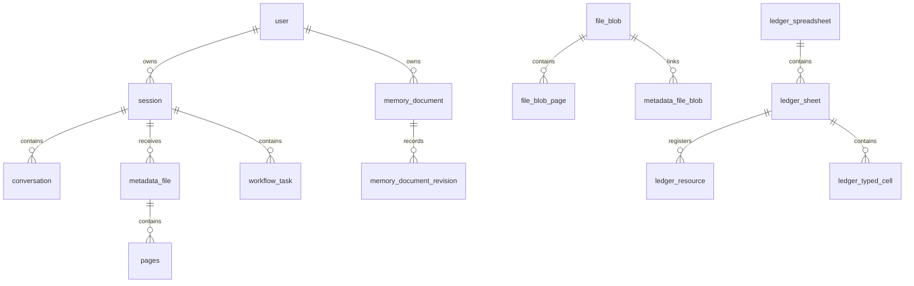
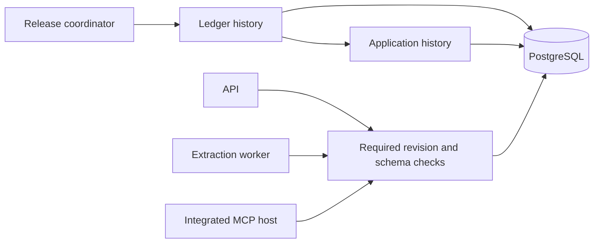

# Database architecture

Klaudia stores application state and ledger records in PostgreSQL. The integrated
installation shares one database and the `public` schema. A standalone ledger
installation needs only ledger objects.

SQLAlchemy metadata describes current owned tables. Alembic revisions manage
schema changes. Runtime stores use asyncpg, with their existing pools and
transaction rules. Domain and agent contracts do not import persistence metadata.
The shared `ledger-postgres` package owns ledger adapters, metadata, revisions
and the existing migration helpers. API and standalone MCP composition use the
same implementation. Application history assets remain in
`app/adapters/persistence/`, with ledger-before-application release order there.
[ADR 0001](decisions/0001-database-migration-schema.mdx) explains these choices,
the Polar reference, and their costs. The
[migration guide](../contributing/database-migrations.mdx) covers contributor and
release procedures.

## Ownership and relationships

An owner controls an object's rules and schema changes. Ownership does not imply
a separate PostgreSQL schema, process, pool, or migration history.

| Owner | History | Tables |
| --- | --- | --- |
| Identity | Application | `user` |
| Chat | Application | `session`, `conversation` |
| Documents | Application | `metadata_file`, `pages`, `file_blob`, `file_blob_page`, `blob_extraction`, `metadata_file_blob` |
| Memory | Application | `memory_document`, `memory_document_revision` |
| Workflow | Application | `workflow_task` |
| Ledger | Ledger | `ledger_spreadsheet`, `ledger_sheet`, `ledger_operation`, `ledger_resource`, `ledger_table_operation`, `ledger_typed_cell` |

The application history records its schema version in `app_alembic_version`;
the ledger history uses `ledger_alembic_version`. These versions are separate
from sheet revisions, memory revisions, operation identities, and approvals.

The diagram shows key declared foreign keys. It omits scalar owner and operation
references. `ledger_spreadsheet.user_id` has no foreign key to application users:
ledger setup works without application tables, and owner `0` represents
system-owned workbooks. Runtime entrypoints check ownership.

Each history also owns the constraints, indexes, and sequences for its tables.
Ledger owns catalogue search indexes, the `pg_trgm` dependency, the generated
search vector, the sheet-revision trigger, and typed-cell guards. Memory owns
checks on paths, owners, byte limits, and tombstones. Migration contracts cover
these PostgreSQL objects as well as table columns.

## Schema lifecycle

One release connection holds a session advisory lock across both histories.
The coordinator checks both starting layouts before writing a version table,
then applies ledger and application revisions in order. Each revision commits
its schema change and recorded version together after checking the expected
catalog. A completed ledger revision can remain recorded if an application
revision fails; services start only after both histories reach the required state.

Runtime startup checks the required versions and owned schema. It does not run
the old startup DDL. Standalone `LedgerStore.connect()` retains automatic ledger
setup through the canonical migration runner; integrated composition checks the
existing schema instead.

Checked adoption supports known populated layouts without rewriting records.
Unknown or partial owned layouts fail before stamping. Unowned objects remain
outside the histories. Older stores can retain unused `pending_approval`,
`memory_history`, `memory_message`, the optional `vector` extension, and a legacy
ledger `request` column. A later cleanup revision needs its own content and
dependency review. See the [adoption rules](../contributing/database-migrations.mdx#existing-databases-and-adoption).

## Runtime transactions

The release connection closes before runtime work. API, worker, and MCP processes
own their runtime pools. A durable workflow task holds its advisory lock on one
task connection; checkpoint writes and checked operations reuse that connection.
Model calls do not hold one transaction open for the whole conversation.

A checked financial effect commits its record changes and receipt in the same
transaction. Retries retain the original operation reference and can return its
existing receipt. Row locks, database revision triggers, typed-cell guards,
approval checks, ownership checks, and exact backend arithmetic protect those
effects. Schema versioning preserves these rules.

## Capacity and open risks

No production load measurement establishes a current database bottleneck.
The following risks come from source and the index inventory. Measure query
plans, waits, and pool use before selecting an optimization.

| Area | Current limit or risk | Evidence needed |
| --- | --- | --- |
| Durable tasks | Each API process has four task connection slots. Model work retains a slot; another acquisition can fail after five seconds. | Task duration, concurrent tasks, pool waits, and busy responses |
| Connections | A default API process and stdio MCP child can open up to 26 database connections; each extraction-worker process can add 10. | Connection use and process counts across replicas |
| Sheet writes | JSONB grid writes lock and rewrite one sheet row, so writes to the same sheet serialize. | Grid size, write latency, and row-lock waits |
| Chat and documents | The baseline lacks composite indexes for conversation history by session/time, sessions by owner/update time, and pages by file/page. | Representative query plans before an index revision |
| User sequence repair | Retained startup repair uses `MAX(user_id)` and can race with account creation or another startup. | A reproducer and a separately reviewed repair change |
| Stored history | Checkpoints, operation payloads, and receipts lack a general retention job; some owner references have no foreign key. | Storage growth and a retention and account-lifecycle policy |

These are follow-up candidates, not changes made by the migration foundation.
Schema checks also add catalog queries at startup; measure that cost as the schema
grows. Passing migration tests does not establish query performance or prove a
future mixed-version rollout. The [target architecture](target.mdx#database-ownership-during-module-moves)
describes how later module moves retain ownership and migration history.
