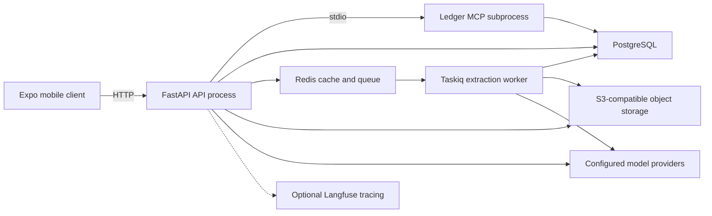
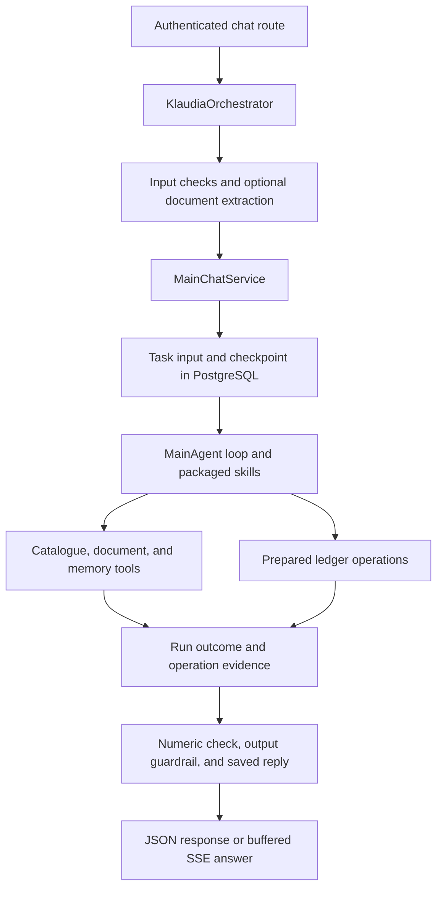
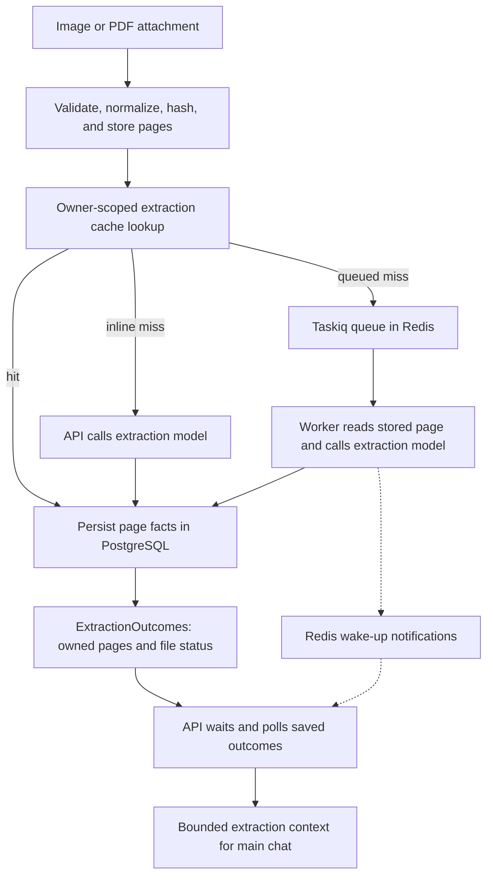

# Current architecture

Klaudia has a FastAPI backend, one main accounting agent, a PostgreSQL ledger,
document extraction, and an Expo mobile client. The API and extraction worker
share application code but run in separate processes. By default, the API starts
the ledger MCP server as a stdio subprocess.

This page describes code at
[5a33e39](https://github.com/Yudhyy/Klaudia/tree/5a33e394748c9a1c7863488402acfa8b96780bd7),
checked on 2026-10-29. It records source structure, not a fresh runtime test or a
release qualification. The [proposed architecture](target.mdx) is separate.
[Issue #3](https://github.com/Yudhyy/Klaudia/issues/3) tracks the assessment and
gradual migration; [issue #4](https://github.com/Yudhyy/Klaudia/issues/4) tracks
the documentation-site setup.

## System and process boundaries

[Docker Compose](https://github.com/Yudhyy/Klaudia/blob/5a33e394748c9a1c7863488402acfa8b96780bd7/docker-compose.yml)
defines the API, worker, PostgreSQL, Redis, object store, and optional sandbox
database. The API and worker use the same image. The mobile client and model
endpoints run outside that Compose stack. Model inference is consumed through
configured providers; this repo does not deploy a model-serving platform.

The Compose service named `minio` currently runs RustFS. Application classes and
environment variables still use MinIO names. That naming is not a requirement
that the storage provider be MinIO. [Issue #5](https://github.com/Yudhyy/Klaudia/issues/5)
tracks the configuration cleanup.

[API startup](https://github.com/Yudhyy/Klaudia/blob/5a33e394748c9a1c7863488402acfa8b96780bd7/app/main.py)
validates settings and creates `KlaudiaContainer` and `KlaudiaOrchestrator`.
The [container](https://github.com/Yudhyy/Klaudia/blob/5a33e394748c9a1c7863488402acfa8b96780bd7/app/services/core/container.py)
opens stores, configures model clients and guardrails, connects the ledger MCP
transport, and supplies services to the orchestrator. The worker creates its own
database, Redis, object-store, and extraction clients through
[worker lifecycle hooks](https://github.com/Yudhyy/Klaudia/blob/5a33e394748c9a1c7863488402acfa8b96780bd7/app/services/extraction/queue/state.py).
It does not reuse live client objects from the API process. The
[MCP host](https://github.com/Yudhyy/Klaudia/blob/5a33e394748c9a1c7863488402acfa8b96780bd7/mcp-ledger/main.py)
selects stdio or Streamable HTTP; its
[server lifespan](https://github.com/Yudhyy/Klaudia/blob/5a33e394748c9a1c7863488402acfa8b96780bd7/mcp-ledger/ledger/server.py)
opens a separate ledger store. These are three process startup paths within the
same application release, each responsible for its own clients and shutdown.

## Chat request path

1. The [chat routes](https://github.com/Yudhyy/Klaudia/blob/5a33e394748c9a1c7863488402acfa8b96780bd7/app/routes/v1/chat.py)
   get identity from the bearer-token dependency and check an existing session's
   owner. The orchestrator resolves an owned active workbook. That workbook is
   a starting hint; resource discovery can inspect other owned workbooks.
2. The [orchestrator](https://github.com/Yudhyy/Klaudia/blob/5a33e394748c9a1c7863488402acfa8b96780bd7/app/services/core/orchestrator.py)
   checks input, handles attachments, and passes bounded extraction context and
   document IDs to the main chat service.
3. [MainChatService](https://github.com/Yudhyy/Klaudia/blob/5a33e394748c9a1c7863488402acfa8b96780bd7/app/services/core/main_chat.py)
   reads recent conversation history, bounds contextual text, stores task input,
   and constructs `MainAgent` with server-bound tool services.
4. The [agent loop](https://github.com/Yudhyy/Klaudia/blob/5a33e394748c9a1c7863488402acfa8b96780bd7/klaudia/core/agent/agent.py)
   calls the configured chat model and bounded tools. The
   [skill registry](https://github.com/Yudhyy/Klaudia/blob/5a33e394748c9a1c7863488402acfa8b96780bd7/klaudia/core/skills/registry.py)
   exposes procedure summaries and loads allowlisted, versioned bodies on demand.
   These are Klaudia runtime skills, separate from a developer's Codex skills.
5. The orchestrator checks the reply's numbers when configured, applies output
   guardrails, saves the assistant message, and returns task status, pending
   approvals, operation references, and receipts alongside the answer.

`POST /v1/chat` returns JSON. `POST /v1/chat/stream` sends progress events, but it
buffers the final model answer until output checks finish. It does not stream
unchecked model tokens directly to the client. A prose check can reject an answer
after an operation has committed; the response retains the operation evidence.

## Ledger reads, writes, and recovery

Main-agent resource reads go through
[CatalogueService](https://github.com/Yudhyy/Klaudia/blob/5a33e394748c9a1c7863488402acfa8b96780bd7/app/services/catalogue/service.py)
and ledger code in the API process. Discovery checks current ownership and returns
bounded resource and revision evidence. Financial queries and native decimal
formulas execute in backend code rather than relying on model arithmetic.

Main-agent writes also call ledger code in process. They prepare an exact request,
store its operation reference, then execute that reference under ownership and
revision checks. The implementation is in
[table operations](https://github.com/Yudhyy/Klaudia/blob/5a33e394748c9a1c7863488402acfa8b96780bd7/mcp-ledger/ledger/table_operations.py),
[table authoring](https://github.com/Yudhyy/Klaudia/blob/5a33e394748c9a1c7863488402acfa8b96780bd7/mcp-ledger/ledger/authoring.py),
and [typed edits](https://github.com/Yudhyy/Klaudia/blob/5a33e394748c9a1c7863488402acfa8b96780bd7/mcp-ledger/ledger/typed_cells.py).
Individual checked operations commit their effect and receipt transactionally.
A multi-step agent task is not one database transaction.

When `MAIN_CHAT_REQUIRE_APPROVAL=true`, the task can pause with an exact pending
proposal. The [approval service](https://github.com/Yudhyy/Klaudia/blob/5a33e394748c9a1c7863488402acfa8b96780bd7/app/services/workflow/approvals.py)
records the decision and executes the stored reference after fresh ledger checks.
The setting defaults to false; table unregister always requires human approval.
Workflow coordinates the human decision, while
[ledger approval code](https://github.com/Yudhyy/Klaudia/blob/5a33e394748c9a1c7863488402acfa8b96780bd7/mcp-ledger/ledger/approvals.py)
binds consent to the stored proposal and enforces it during execution.
Resume through the
[task routes](https://github.com/Yudhyy/Klaudia/blob/5a33e394748c9a1c7863488402acfa8b96780bd7/app/routes/v1/tasks.py)
continues stored intent and pending calls; it does not accept a replacement task
body. [Task storage](https://github.com/Yudhyy/Klaudia/blob/5a33e394748c9a1c7863488402acfa8b96780bd7/app/services/workflow/store.py)
keeps checkpoints in PostgreSQL and holds the task lock and ledger writes on the
same database connection. Recovery reuses original operation references. The
chat service does not automatically retry a stopped task.

The [sheet HTTP routes](https://github.com/Yudhyy/Klaudia/blob/5a33e394748c9a1c7863488402acfa8b96780bd7/app/routes/v1/sheets.py)
resolve workbook ownership and forward signed owner identity through the ledger
MCP registry. The
[authorization middleware](https://github.com/Yudhyy/Klaudia/blob/5a33e394748c9a1c7863488402acfa8b96780bd7/mcp-ledger/ledger/authorization.py)
advertises nine read tools, denies mutation handlers, and holds current workbook
ownership through each allowed read, including batch reads. Checked financial
writes use the application path described above. Scoped authorization was added
in [PR #20](https://github.com/Yudhyy/Klaudia/pull/20).

The supported MCP transports are stdio and Streamable HTTP. Legacy HTTP+SSE was
removed in [PR #22](https://github.com/Yudhyy/Klaudia/pull/22). See the
[MCP contract and migration guide](https://github.com/Yudhyy/Klaudia/blob/5a33e394748c9a1c7863488402acfa8b96780bd7/mcp-ledger/README.md)
for signed identity, authentication, Host/Origin configuration, and protocol
compatibility. Native decimal formulas do not establish IronCalc or Excel support.

## Document extraction path

[IngestService](https://github.com/Yudhyy/Klaudia/blob/5a33e394748c9a1c7863488402acfa8b96780bd7/app/services/extraction/ingest.py)
validates attachments, normalizes images, renders PDF pages, and builds
content-addressed BLAKE3 references. Object storage holds source files and page
images. Redis supplies the first cache lookup; PostgreSQL supplies persistent
cached extraction and document/page records.

Non-streaming chat calls extraction inline before the main agent runs, even when
`EXTRACTION_MODE=async`. Streaming chat uses the setting to choose inline or
queued extraction. In queued mode, cache hits persist directly; each cache miss
enqueues a page reference. The
[worker task](https://github.com/Yudhyy/Klaudia/blob/5a33e394748c9a1c7863488402acfa8b96780bd7/app/services/extraction/queue/tasks.py)
reads the stored image, calls the extraction provider, validates the structured
output, and persists it. The
[broker](https://github.com/Yudhyy/Klaudia/blob/5a33e394748c9a1c7863488402acfa8b96780bd7/app/services/extraction/queue/broker.py)
uses separate configured Redis URLs for the queue and result backend.

[ExtractionOutcomes](https://github.com/Yudhyy/Klaudia/blob/5a33e394748c9a1c7863488402acfa8b96780bd7/app/services/extraction/outcomes.py)
owns queued page completion and aggregate file status. It checks file and session
ownership, resolves expected page identities, and commits each terminal page and
the file roll-up together. Worker writes continue after an API disconnect; a
failed retry preserves an already saved success.

The [progress helper](https://github.com/Yudhyy/Klaudia/blob/5a33e394748c9a1c7863488402acfa8b96780bd7/app/services/extraction/queue/progress.py)
subscribes before its first outcome read and polls saved outcomes within a bounded
wait. Redis messages only wake that check. Duplicate or missed notifications do
not count as completed pages. At the deadline, pending pages remain pending and
the stream reports deferred work; a late worker can still save the terminal
outcome. The orchestrator consumes the bounded outcome rather than implementing
the queued file-status rule. This separation was added in
[PR #23](https://github.com/Yudhyy/Klaudia/pull/23). Extraction supplies document
facts; a later checked operation performs any financial write.

The main agent can retrieve more document evidence through
[ArchiveTools](https://github.com/Yudhyy/Klaudia/blob/5a33e394748c9a1c7863488402acfa8b96780bd7/app/services/core/archive_tools.py).
Document search and page reads bind the authenticated owner and check file and
session ownership. Retrieved content supplies facts, not execution authority.

## Durable state and module ownership

| State | Current implementation |
| --- | --- |
| Identity, sessions, conversation, document metadata, pages, extraction cache | `AppDBClient` in `app/services/extraction/infra/db_client.py` |
| Sheet grids, resource catalogue, native formulas, operations, receipts | `mcp-ledger/ledger/` |
| Agent task input, checkpoint storage, status and human-decision routing | `app/services/workflow/` and `app/services/core/main_chat.py` |
| Human preferences, conventions, accounting policy, revision history | `app/services/memory/` |
| Source documents and page images | S3-compatible object storage |
| Cache, extraction queue, result backend, progress events | Redis |

These are logical responsibilities within the configured stores. They are not a
claim that separate PostgreSQL schemas or services exist for each row. Current
database code uses asyncpg and initializes tables through store startup code.
The target design's SQLAlchemy and versioned migration layout are proposals.
Application memory documents are described in
[the memory contract](https://github.com/Yudhyy/Klaudia/blob/5a33e394748c9a1c7863488402acfa8b96780bd7/docs/CONTEXT.md).
They are separate from financial facts and developer-agent notes.

| Change area | Start here |
| --- | --- |
| HTTP contract or mobile caller | `app/routes/v1/`, `app/models/`, `apps/mobile/services/` |
| Startup wiring, configured providers | `app/services/core/container.py`, `config/settings.py`, `klaudia/core/agent/llm.py` |
| Agent steps, tool context, runtime skill procedures | `klaudia/core/agent/`, `klaudia/core/skills/` |
| Catalogue, authoring, memory policy | `app/services/catalogue/`, `app/services/memory/`, associated ledger modules |
| Checked financial effects and deterministic calculations | `mcp-ledger/ledger/` |
| Task recovery and human decisions | `app/services/workflow/`, `app/services/core/main_chat.py` |
| Document ingestion and background work | `app/services/extraction/` |

This map records current dependencies. `klaudia/` uses LangChain model/tool types
and ledger contracts. Application services import ledger implementations directly.
The extraction database client also owns identity and conversation tables.
[PR #25](https://github.com/Yudhyy/Klaudia/pull/25) separated append and authoring
proposal definitions from persistence. Agent tools import pure ledger contracts;
legacy execution-module paths re-export the same types. The
[agent package metadata](https://github.com/Yudhyy/Klaudia/blob/5a33e394748c9a1c7863488402acfa8b96780bd7/klaudia/pyproject.toml)
now declares its existing `mcp-ledger` workspace dependency.

The [import checks](https://github.com/Yudhyy/Klaudia/blob/5a33e394748c9a1c7863488402acfa8b96780bd7/tests/unit/test_architecture_imports.py)
protect specific dependency rules and load contracts and the main agent with
database, MCP, FastAPI, app and config imports blocked. This checks import
isolation in the installed workspace. It does not prove independent installation:
the ledger distribution still declares PostgreSQL and MCP dependencies, and
`klaudia/interfaces/tool_registry.py` still imports FastMCP. These modules have
not yet become the independent packages in the target tree.

## Verification and next work

The repo has unit, real-service integration, and opt-in live-model evaluation
checks. See the
[evaluation guide](https://github.com/Yudhyy/Klaudia/blob/5a33e394748c9a1c7863488402acfa8b96780bd7/tests/e2e/README.md)
and [CI definitions](https://github.com/Yudhyy/Klaudia/blob/5a33e394748c9a1c7863488402acfa8b96780bd7/.circleci/continue.yml).
Relevant suites cover main chat, durable task recovery, checked ledger operations,
and inline/queued extraction. A test file's presence is not a fresh pass result.
Historical benchmarks do not qualify a new architecture or release.

The [architecture assessment](assessment.mdx) records remaining coupling,
transaction constraints, and acceptance criteria for the first installable
ledger-core slice. The [target](target.mdx#module-ownership) assigns module
ownership and distinguishes current, transitional and final dependencies.
Documentation-site setup remains separate work under #4; this checkout has no
Docusaurus package manifest or documentation build command. This page is a source
review, not a new application test, CI result, or package migration.
