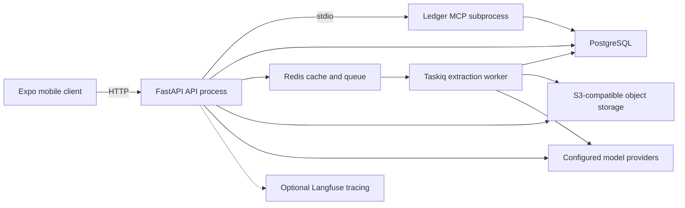
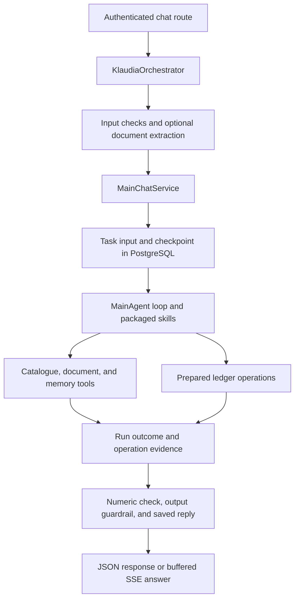
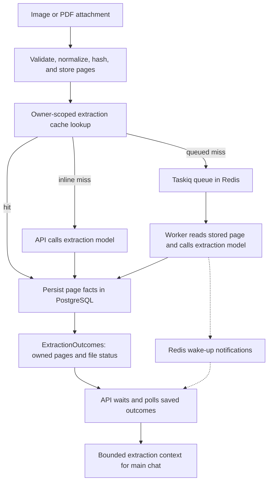

# Current architecture

The [database architecture](database.mdx) describes the owned Alembic histories,
release order, startup checks, retained legacy objects, and recovery added after
the source snapshot below.

Klaudia has a FastAPI backend, one main accounting agent, a PostgreSQL ledger,
document extraction, and an Expo mobile client. The API and extraction worker
share application code but run in separate processes. By default, the API starts
the ledger MCP server as a stdio subprocess.

This page describes code at
[5a33e39](https://github.com/Yudhyy/Klaudia/tree/5a33e394748c9a1c7863488402acfa8b96780bd7),
checked on 2026-10-29. It records source structure, not a fresh runtime test or a
release qualification. The [proposed architecture](target.mdx) is separate.
The [ledger-core follow-up](#ledger-core-extraction-follow-up) records the package
extraction added after that revision; the earlier source links remain pinned.
[Issue #3](https://github.com/Yudhyy/Klaudia/issues/3) tracks the assessment and
gradual migration; [issue #4](https://github.com/Yudhyy/Klaudia/issues/4) tracks
the documentation-site setup.

## System and process boundaries

[Docker Compose](https://github.com/Yudhyy/Klaudia/blob/5a33e394748c9a1c7863488402acfa8b96780bd7/docker-compose.yml)
defines the API, worker, PostgreSQL, Redis, object store, and optional sandbox
database. The API and worker use the same image. The mobile client and model
endpoints run outside that Compose stack. Model inference is consumed through
configured providers; this repo does not deploy a model-serving platform.

The Compose service named `minio` currently runs RustFS. Application classes and
environment variables still use MinIO names. That naming is not a requirement
that the storage provider be MinIO. [Issue #5](https://github.com/Yudhyy/Klaudia/issues/5)
tracks the configuration cleanup.

[API startup](https://github.com/Yudhyy/Klaudia/blob/5a33e394748c9a1c7863488402acfa8b96780bd7/app/main.py)
validates settings and creates `KlaudiaContainer` and `KlaudiaOrchestrator`.
The [container](https://github.com/Yudhyy/Klaudia/blob/5a33e394748c9a1c7863488402acfa8b96780bd7/app/services/core/container.py)
opens stores, configures model clients and guardrails, connects the ledger MCP
transport, and supplies services to the orchestrator. The worker creates its own
database, Redis, object-store, and extraction clients through
[worker lifecycle hooks](https://github.com/Yudhyy/Klaudia/blob/5a33e394748c9a1c7863488402acfa8b96780bd7/app/services/extraction/queue/state.py).
It does not reuse live client objects from the API process. The
[MCP host](https://github.com/Yudhyy/Klaudia/blob/5a33e394748c9a1c7863488402acfa8b96780bd7/mcp-ledger/main.py)
selects stdio or Streamable HTTP; its
[server lifespan](https://github.com/Yudhyy/Klaudia/blob/5a33e394748c9a1c7863488402acfa8b96780bd7/mcp-ledger/ledger/server.py)
opens a separate ledger store. These are three process startup paths within the
same application release, each responsible for its own clients and shutdown.

## Chat request path

1. The [chat routes](https://github.com/Yudhyy/Klaudia/blob/5a33e394748c9a1c7863488402acfa8b96780bd7/app/routes/v1/chat.py)
   get identity from the bearer-token dependency and check an existing session's
   owner. The orchestrator resolves an owned active workbook. That workbook is
   a starting hint; resource discovery can inspect other owned workbooks.
2. The [orchestrator](https://github.com/Yudhyy/Klaudia/blob/5a33e394748c9a1c7863488402acfa8b96780bd7/app/services/core/orchestrator.py)
   checks input, handles attachments, and passes bounded extraction context and
   document IDs to the main chat service.
3. [MainChatService](https://github.com/Yudhyy/Klaudia/blob/5a33e394748c9a1c7863488402acfa8b96780bd7/app/services/core/main_chat.py)
   reads recent conversation history, bounds contextual text, stores task input,
   and constructs `MainAgent` with server-bound tool services.
4. The [agent loop](https://github.com/Yudhyy/Klaudia/blob/5a33e394748c9a1c7863488402acfa8b96780bd7/klaudia/core/agent/agent.py)
   calls the configured chat model and bounded tools. The
   [skill registry](https://github.com/Yudhyy/Klaudia/blob/5a33e394748c9a1c7863488402acfa8b96780bd7/klaudia/core/skills/registry.py)
   exposes procedure summaries and loads allowlisted, versioned bodies on demand.
   These are Klaudia runtime skills, separate from a developer's Codex skills.
5. The orchestrator checks the reply's numbers when configured, applies output
   guardrails, saves the assistant message, and returns task status, pending
   approvals, operation references, and receipts alongside the answer.

`POST /v1/chat` returns JSON. `POST /v1/chat/stream` sends progress events, but it
buffers the final model answer until output checks finish. It does not stream
unchecked model tokens directly to the client. A prose check can reject an answer
after an operation has committed; the response retains the operation evidence.

## Ledger reads, writes, and recovery

Main-agent resource reads go through
[CatalogueService](https://github.com/Yudhyy/Klaudia/blob/5a33e394748c9a1c7863488402acfa8b96780bd7/app/services/catalogue/service.py)
and ledger code in the API process. Discovery checks current ownership and returns
bounded resource and revision evidence. Financial queries and native decimal
formulas execute in backend code rather than relying on model arithmetic.

Main-agent writes also call ledger code in process. They prepare an exact request,
store its operation reference, then execute that reference under ownership and
revision checks. The implementation is in
[table operations](https://github.com/Yudhyy/Klaudia/blob/5a33e394748c9a1c7863488402acfa8b96780bd7/mcp-ledger/ledger/table_operations.py),
[table authoring](https://github.com/Yudhyy/Klaudia/blob/5a33e394748c9a1c7863488402acfa8b96780bd7/mcp-ledger/ledger/authoring.py),
and [typed edits](https://github.com/Yudhyy/Klaudia/blob/5a33e394748c9a1c7863488402acfa8b96780bd7/mcp-ledger/ledger/typed_cells.py).
Individual checked operations commit their effect and receipt transactionally.
A multi-step agent task is not one database transaction.

When `MAIN_CHAT_REQUIRE_APPROVAL=true`, the task can pause with an exact pending
proposal. The [approval service](https://github.com/Yudhyy/Klaudia/blob/5a33e394748c9a1c7863488402acfa8b96780bd7/app/services/workflow/approvals.py)
records the decision and executes the stored reference after fresh ledger checks.
The setting defaults to false; table unregister always requires human approval.
Workflow coordinates the human decision, while
[ledger approval code](https://github.com/Yudhyy/Klaudia/blob/5a33e394748c9a1c7863488402acfa8b96780bd7/mcp-ledger/ledger/approvals.py)
binds consent to the stored proposal and enforces it during execution.
Resume through the
[task routes](https://github.com/Yudhyy/Klaudia/blob/5a33e394748c9a1c7863488402acfa8b96780bd7/app/routes/v1/tasks.py)
continues stored intent and pending calls; it does not accept a replacement task
body. [Task storage](https://github.com/Yudhyy/Klaudia/blob/5a33e394748c9a1c7863488402acfa8b96780bd7/app/services/workflow/store.py)
keeps checkpoints in PostgreSQL and holds the task lock and ledger writes on the
same database connection. Recovery reuses original operation references. The
chat service does not automatically retry a stopped task.

The [sheet HTTP routes](https://github.com/Yudhyy/Klaudia/blob/5a33e394748c9a1c7863488402acfa8b96780bd7/app/routes/v1/sheets.py)
resolve workbook ownership and forward signed owner identity through the ledger
MCP registry. The
[authorization middleware](https://github.com/Yudhyy/Klaudia/blob/5a33e394748c9a1c7863488402acfa8b96780bd7/mcp-ledger/ledger/authorization.py)
advertises nine read tools, denies mutation handlers, and holds current workbook
ownership through each allowed read, including batch reads. Checked financial
writes use the application path described above. Scoped authorization was added
in [PR #20](https://github.com/Yudhyy/Klaudia/pull/20).

The supported MCP transports are stdio and Streamable HTTP. Legacy HTTP+SSE was
removed in [PR #22](https://github.com/Yudhyy/Klaudia/pull/22). See the
[MCP contract and migration guide](https://github.com/Yudhyy/Klaudia/blob/5a33e394748c9a1c7863488402acfa8b96780bd7/mcp-ledger/README.md)
for signed identity, authentication, Host/Origin configuration, and protocol
compatibility. Native decimal formulas do not establish IronCalc or Excel support.

## Document extraction path

[IngestService](https://github.com/Yudhyy/Klaudia/blob/5a33e394748c9a1c7863488402acfa8b96780bd7/app/services/extraction/ingest.py)
validates attachments, normalizes images, renders PDF pages, and builds
content-addressed BLAKE3 references. Object storage holds source files and page
images. Redis supplies the first cache lookup; PostgreSQL supplies persistent
cached extraction and document/page records.

Non-streaming chat calls extraction inline before the main agent runs, even when
`EXTRACTION_MODE=async`. Streaming chat uses the setting to choose inline or
queued extraction. In queued mode, cache hits persist directly; each cache miss
enqueues a page reference. The
[worker task](https://github.com/Yudhyy/Klaudia/blob/5a33e394748c9a1c7863488402acfa8b96780bd7/app/services/extraction/queue/tasks.py)
reads the stored image, calls the extraction provider, validates the structured
output, and persists it. The
[broker](https://github.com/Yudhyy/Klaudia/blob/5a33e394748c9a1c7863488402acfa8b96780bd7/app/services/extraction/queue/broker.py)
uses separate configured Redis URLs for the queue and result backend.

[ExtractionOutcomes](https://github.com/Yudhyy/Klaudia/blob/5a33e394748c9a1c7863488402acfa8b96780bd7/app/services/extraction/outcomes.py)
owns queued page completion and aggregate file status. It checks file and session
ownership, resolves expected page identities, and commits each terminal page and
the file roll-up together. Worker writes continue after an API disconnect; a
failed retry preserves an already saved success.

The [progress helper](https://github.com/Yudhyy/Klaudia/blob/5a33e394748c9a1c7863488402acfa8b96780bd7/app/services/extraction/queue/progress.py)
subscribes before its first outcome read and polls saved outcomes within a bounded
wait. Redis messages only wake that check. Duplicate or missed notifications do
not count as completed pages. At the deadline, pending pages remain pending and
the stream reports deferred work; a late worker can still save the terminal
outcome. The orchestrator consumes the bounded outcome rather than implementing
the queued file-status rule. This separation was added in
[PR #23](https://github.com/Yudhyy/Klaudia/pull/23). Extraction supplies document
facts; a later checked operation performs any financial write.

The main agent can retrieve more document evidence through
[ArchiveTools](https://github.com/Yudhyy/Klaudia/blob/5a33e394748c9a1c7863488402acfa8b96780bd7/app/services/core/archive_tools.py).
Document search and page reads bind the authenticated owner and check file and
session ownership. Retrieved content supplies facts, not execution authority.

## Durable state and module ownership

| State | Current implementation |
| --- | --- |
| Credential lookup, account creation, last-login updates | `IdentityStore` in `identity_core.ports`, implemented by `app/adapters/identity.py` |
| Application database pool, startup checks and seed user | `ApplicationDatabase` in `app/adapters/persistence/application.py`; the former `AppDBClient` import remains compatible |
| Sessions, recent history and conversation messages | `ConversationStore` in `app/services/conversation/store.py`, implemented by `app/adapters/persistence/conversations.py` |
| Document metadata, pages, extraction cache and saved outcomes | `packages/document-intelligence/` contracts and interfaces. PostgreSQL adapters in `app/adapters/persistence/` |
| Sheet grids, resource catalogue, checked operations, approvals, receipts | Shared `ledger-postgres` adapters; pure calculations and formulas in `ledger-core` |
| Task lifecycle, progress and human-decision interfaces | `packages/workflow-core/`; application adapters store checkpoints and bind agent runs |
| Human preferences, conventions, accounting policy, revision history | Contracts and interfaces in `packages/memory-core/`. PostgreSQL adapter in `app/adapters/persistence/memory.py` |
| Source documents and page images | S3-compatible object storage |
| Cache, extraction queue, result backend, progress events | Redis |

These are logical responsibilities within the configured stores. They are not a
claim that separate PostgreSQL schemas or services exist for each row. Current
database code uses asyncpg and initializes tables through store startup code.
The target design's SQLAlchemy and versioned migration layout are proposals.
Application memory documents are described in
[the memory contract](https://github.com/Yudhyy/Klaudia/blob/5a33e394748c9a1c7863488402acfa8b96780bd7/docs/CONTEXT.md).
They are separate from financial facts and developer-agent notes.

| Change area | Start here |
| --- | --- |
| HTTP contract or mobile caller | `app/routes/v1/`, `app/models/`, `apps/mobile/services/` |
| Startup wiring, configured providers | `app/services/core/container.py`, `config/settings.py`, `app/adapters/llm/model_factory.py` |
| Registration/login rules and adapters | `packages/identity-core/`, `app/adapters/identity.py`, `app/adapters/auth/` |
| Agent steps, tool context, runtime skill procedures | `packages/agent-core/src/agent_core/agent/`, `packages/agent-skills/src/agent_skills/` |
| Catalogue, authoring, memory policy | `app/services/catalogue/`, `packages/memory-core/`, `app/adapters/ledger/reconciliation.py` and associated ledger modules |
| Checked financial effects and deterministic calculations | `packages/ledger-postgres/`, `packages/ledger-core/` |
| Task recovery and human decisions | `packages/workflow-core/`, `app/services/core/main_chat.py`, `app/adapters/persistence/tasks.py` |
| Document ingestion and background work | `app/services/extraction/` |
| Document persistence and queued outcomes | `packages/document-intelligence/`, `app/adapters/persistence/documents.py`, `app/adapters/persistence/extraction_outcomes.py` |
| Session and message persistence | `app/services/conversation/store.py`, `app/adapters/persistence/conversations.py` |

This map points to current paths. At the recorded baseline, `klaudia/` used
LangChain model/tool types and ledger contracts. The follow-ups below describe
the later package and contract changes. Application services import ledger implementations directly.
The extraction database client still initializes identity and conversation tables;
its identity methods now forward to the application identity adapter.
[PR #25](https://github.com/Yudhyy/Klaudia/pull/25) separated append and authoring
proposal definitions from persistence. Agent tools import pure ledger contracts;
legacy execution-module paths re-export the same types. The
[agent package metadata](https://github.com/Yudhyy/Klaudia/blob/5a33e394748c9a1c7863488402acfa8b96780bd7/klaudia/pyproject.toml)
now declares its existing `mcp-ledger` workspace dependency.

The [import checks](https://github.com/Yudhyy/Klaudia/blob/5a33e394748c9a1c7863488402acfa8b96780bd7/tests/unit/test_architecture_imports.py)
protect specific dependency rules and load contracts and the main agent with
database, MCP, FastAPI, app and config imports blocked. This checks import
isolation in the installed workspace. It does not prove independent installation:
the ledger distribution still declares PostgreSQL and MCP dependencies, and
`klaudia/interfaces/tool_registry.py` still imports FastMCP. These modules have
not yet become the independent packages in the target tree.

## Ledger-core extraction follow-up

The current source adds `packages/ledger-core/src/ledger_core/` as an installable
workspace package. It owns the eleven pure contract, resource/error, evidence,
grid/query and native decimal formula modules described in the
[assessment](assessment.mdx#first-extraction-installable-ledger-core). Pydantic
is its only runtime dependency. Existing `ledger.*` paths re-export the same
definitions, including proposal types imported from the old execution modules.

Application, agent and ledger consumers import the canonical core directly.
At extraction, the agent declared `ledger-core` and FastMCP directly rather
than installing `mcp-ledger` to obtain its request types and MCP client library.
The MCP client adapter remained in `klaudia/interfaces/` until the separate
client move described below.

`tests/packaging/test_ledger_core.py` builds the wheel and installs it into a fresh
environment outside the checkout, without the legacy ledger, PostgreSQL or MCP
libraries. It exercises installed imports, contract JSON/schema fixtures, exact
aggregation and formula rounding. Import-policy checks cover the entire core;
compatibility tests check canonical/legacy identity. The unit CI job also runs
the packaging checks, and core-path changes select backend CI.

Checked execution, ownership, approvals, original operation references and
task-lock connection ownership retain their existing implementation. The
broader ownership migration remains in the [target](target.mdx#migration-sequence).

## MCP client separation follow-up

The outbound client now lives in `app/adapters/mcp_client/tool_registry.py`.
Application composition and sheet routes import it there. The old
`klaudia.interfaces.MCPToolRegistry` and `klaudia.interfaces.tool_registry`
imports are removed; no compatibility shim imports application code into the
agent. The root application declares FastMCP directly. The agent wheel excludes
the client and no longer declares FastMCP or MCP dependencies.

The client retains stdio, Streamable HTTP, signed owner forwarding, tool schema
normalization and failure/shutdown behavior. The MCP host and checked financial
write path retain their implementations. Packaging checks install the agent
wheel outside the checkout, run a scripted agent and load every skill with
application, ledger, database and MCP libraries absent. The ledger capability
split below removes the agent's remaining ledger-core dependency. LangChain,
provider construction and runtime/skills extraction followed in the package
extraction below.

## Document, memory and policy capability adapters

The agent now owns document, memory and policy tool schemas and binding in
`packages/agent-core/src/agent_core/agent/documents.py`, `memory.py` and `reconciliation.py`.
Its [consumer interfaces](https://github.com/Yudhyy/Klaudia/tree/development/packages/agent-core/src/agent_core/agent/ports)
accept document reads, context reads and typed reconciliation intent. These
interfaces do not import application stores or saved policy models. The memory
tool has its own path enum; the backend converts it to its stored document path.
Policy intent now uses agent-owned field types from the ledger capability split.

[MainChatService](https://github.com/Yudhyy/Klaudia/blob/development/app/services/core/main_chat.py)
binds each backend to the authenticated turn owner, then supplies the agent-owned
tools. `MainAgent` retains its framework tool inputs for this step. Fake
implementations can exercise these tools without application or database code.

The existing backend methods now serve as capability adapters. `ArchiveReader`
in `app/services/core/archive_tools.py` uses the document archive interface and
retains pagination and evidence fields. Its persistence adapter checks file and
session ownership. `MemoryReader` in `memory_core.tools`
retains owner-scoped reads and trust labels. `PolicyReconciler` in
`app/adapters/ledger/reconciliation.py` retains saved policy checks before and
after the read, source ownership/revisions, exact ledger reconciliation and
evidence limits. Agent code does not select accounting rules or calculate
financial results. The old application tool-builder classes have no compatibility
aliases; repository callers now use the agent builders and backend readers.

The fixed fixtures from PR #33 check complete tool schemas, descriptions,
requests, results, error messages and checkpoint hashes during this split.
Import checks protect agent isolation and reject direct tool-framework imports
in these three adapters. Packaging checks run the four read tools from an
installed wheel with application, database and MCP modules absent. Ledger
execution, approvals, task connections and continuation storage retain their
existing implementations.

### Memory storage boundary

The [memory interfaces](https://github.com/Yudhyy/Klaudia/blob/development/packages/memory-core/src/memory_core/ports.py)
separate owner-scoped context reads from human edits. `DocumentReader` returns
the current document, tombstone or missing state. `DocumentRepository` adds
expected-revision writes and deletion, with current value and history committed
together. Memory owns the bounded document and structured policy contracts.

The [PostgreSQL adapter](https://github.com/Yudhyy/Klaudia/blob/development/app/adapters/persistence/memory.py)
retains the existing SQL, transactions, migration check and application pool.
Composition supplies it to routes and chat. Context tools and saved-policy
reconciliation depend on the read interface. Replay checks use the same reader
on the task connection that holds the lock; they no longer contain memory SQL.
Changed, deleted or restored policy revisions still stop saved reconciliation
replay. Document and workbook access checks retain their current implementation.

The installed `memory-core` package contains the contracts, interfaces and
context reader, with Pydantic as its only direct runtime dependency. The former
application memory paths retain aliases. Import and wheel checks protect this
boundary and exercise owner-scoped policy reads with exact decimal values.

### Document and conversation storage boundaries

The [document interfaces](https://github.com/Yudhyy/Klaudia/blob/development/packages/document-intelligence/src/document_intelligence/ports.py)
separate upload preparation and extraction caches, owner-checked archive reads,
and saved queued outcomes. [Document contracts](https://github.com/Yudhyy/Klaudia/blob/development/packages/document-intelligence/src/document_intelligence/contracts.py)
own expected-page identity, bounded saved facts, pending-page state and the
existing chat payload. Ingestion, archive tools and progress reconciliation use
these interfaces instead of raw database queries. API and worker composition
supply the concrete stores.

The [document adapter](https://github.com/Yudhyy/Klaudia/blob/development/app/adapters/persistence/documents.py)
retains file/session owner checks, literal filename search, page text bounds,
blob records and extraction cache queries. The
[queued outcome adapter](https://github.com/Yudhyy/Klaudia/blob/development/app/adapters/persistence/extraction_outcomes.py)
retains the file/session lock and transaction for page writes and file status.
Missing pages stay pending; failed retries preserve saved success. Redis events
still wake a check of saved outcomes. Deadlines retain their current bounds.
Task replay checks document access through the archive interface on the
connection holding the task lock.

The [conversation interface](https://github.com/Yudhyy/Klaudia/blob/development/app/services/conversation/store.py)
serves session routes, chat history and operation recovery evidence without an
extraction-client dependency. Its
[PostgreSQL adapter](https://github.com/Yudhyy/Klaudia/blob/development/app/adapters/persistence/conversations.py)
keeps the existing message order, identifiers and timestamp updates. Authenticated
callers retain their session ownership checks before reading or writing a
selected session.

`ApplicationDatabase` owns the existing application pool, migration check and
seed behavior. The former `AppDBClient` import aliases it; legacy domain methods
forward to the canonical stores. The former `ExtractionOutcomes` constructor
adapts a database client to the same pool-based outcome implementation.

`document-intelligence` installs the contracts, upload preparation, inline
ingestion and queued page processing with only the standard library. The API
adapter translates uploads and errors, and supplies media processing and page
dispatch. The worker supplies the same storage, cache and OCR capabilities and
publishes Redis notifications after the page outcome is saved. Taskiq owns job
registration and retry settings. The progress adapter reads saved outcomes
through the document interface. Process relocation remains proposed.

## Ledger capability contracts

The agent owns its catalogue, calculation, financial-read, append, authoring and
typed-edit request shapes under `packages/agent-core/src/agent_core/agent/ports/`. It also owns the
expected missing-resource, overlap, revision and approval failures. Tool schemas
retain their release descriptions, defaults and nested definitions, including
the native formula request shape. The agent does not include formula evaluation,
grid arithmetic, receipt storage or ledger approval rules.

[Application adapters](https://github.com/Yudhyy/Klaudia/tree/development/app/adapters/agent)
translate those requests into canonical ledger models and map only the expected
failures. Backend validation still checks authoring actions, decimal bounds,
formula arity, typed values and required rounding before persistence. Unknown
and infrastructure failures propagate. HTTP services keep their ledger models,
methods and error types. Policy reconciliation keeps its saved-policy and exact
calculation rules; its adapter maps failures for the agent.

`MainChatService` wraps the executor selected for the current run. Durable tasks
still use `TaskSession` and its lock-holding `TaskConnection`; standalone runs
still use `OperationService`. The adapter opens no pool and does not replace
the original operation reference, approval payload or committed receipt.
Session journaling and task checkpoints retain their existing write order.

The agent manifest no longer declares ledger-core. Import checks reject ledger
and ledger-core throughout the agent package. Installed-wheel checks run read,
append, authoring and typed-edit tools through fake consumer capabilities with
both ledger distributions absent. Frozen release fixtures still cover all 32
capability combinations and old continuations. The next follow-up extracts the
runtime/skills packages and moves provider construction.

## Runtime and skills package extraction

The canonical agent now lives in `packages/agent-core/src/agent_core/agent/`.
`packages/agent-skills/src/agent_skills/` owns the registry and all procedure
files. The runtime retains its prompt, model/tool types and internal structure.
The earlier `klaudia/core/agent/` and `klaudia/core/skills/registry.py` paths above
now re-export the same canonical definitions. The procedures have one copy;
their names, versions, descriptions and exact bytes stay unchanged.

Application composition and capability adapters import `agent_core.agent` and
`agent_skills`. Model construction now belongs to
`app/adapters/llm/model_factory.py`. The old `klaudia.core.agent.llm` path is
removed; it cannot re-export application code into the compatibility package.
The root application owns the provider libraries and its TOON context encoder
dependency. The runtime depends on LangChain core, Pydantic and agent-skills;
the skills package depends on Pydantic alone.

The packaging suite installs the skills alone, the canonical runtime with
skills, and the compatibility distribution in separate environments outside
the checkout. These checks load every skill, compare saved procedure bytes and
exercise scripted tools with application, ledger, database, MCP and concrete
model-provider libraries absent. Legacy imports keep class and error identity.
Frozen tool schemas, prompts and saved continuation identities remain the
compatibility tests. Workflow, memory, documents and identity extraction remain
under issue #3.

## Identity storage interface

Registration and login routes use `container.identity_service`, an
`IdentityService` from `packages/identity-core/`. The use cases own account lookup,
duplicate checks, password verification, last-login updates and token issuance
order. They receive `IdentityStore`, `PasswordHasher` and `TokenIssuer` capabilities
from composition. HTTP retains validation, rate limits and response mapping.

`IdentityStore` now lives in `identity_core.ports`. The PostgreSQL adapter in
`app/adapters/identity.py` owns credential lookup, account creation and last-login
SQL. Composition supplies the existing application pool after
`ApplicationDatabase.connect`; the adapter does not create a pool, initialize
tables or close shared resources. `app/adapters/auth/` owns bcrypt and JWT helpers
and supplies the configured password and token implementations.

The three existing `AppDBClient` method names remain thin forwards for retained
callers. Their SQL has one implementation. The former auth store/password/token
paths retain compatibility imports. Password hashing, conflict responses, JWT
claims and lifetime, timestamps and the HTTP contract retain their behavior.

Import checks restrict identity-core to the standard library. An independent
wheel test runs registration and login with no application, HTTP, database or
crypto libraries installed. Auth route, identity storage and startup regressions
cover the concrete adapters. The persistence interface was delivered under
[issue #16](https://github.com/Yudhyy/Klaudia/issues/16); this package adds no
roles, refresh sessions, account deletion or token revocation. The larger identity
tree and account lifecycle work remain separate.

## Workflow boundary

`WorkflowService` in `packages/workflow-core/src/workflow_core/service.py` coordinates task
creation, exclusive execution, resume, stop status and failure recovery. Its
storage and run interfaces do not import agent, ledger or infrastructure code.
The application supplies a run bound to the original stored input and acquired
session. Workflow records the returned status; the application interprets the
agent continuation and builds the response.

| Responsibility | Current implementation |
| --- | --- |
| Task, progress and human-decision interfaces | `packages/workflow-core/src/workflow_core/ports.py` |
| Task SQL, checkpoint storage, pools and advisory locks | `app/adapters/persistence/tasks.py` |
| Checked writes on the task connection and authoritative operation evidence | `app/adapters/ledger/task_operations.py` |
| Exact human approval decisions and execution | `app/adapters/ledger/approvals.py` |
| Saved-agent-state interpretation and replay access checks | `app/adapters/agent/checkpoints.py` |
| Original chat input, agent construction and outcome translation | `app/services/core/main_chat.py` |

Task and approval HTTP callers use the workflow interfaces. Composition creates
the concrete adapters. The former workflow interface, service, store and approval
modules retain import aliases for existing callers. The core depends only on the
standard library. Package-wide import checks and independent installed execution
keep application, agent, ledger and infrastructure dependencies outside the core.

This changes module ownership, not task storage or execution policy. Task-bound
checkpoints and checked writes still use the connection holding the advisory
lock. Financial effects and receipts still commit together in short transactions.
Human decisions remain separate requests, and ledger validates each exact stored
proposal. Old checkpoints, original references and public responses retain their
formats. A frozen pre-change API checkpoint and the existing database approval,
replay, ownership and process-recovery suites protect these contracts.

The installed-wheel check covers task start/resume, original stored identity,
failure recovery, cancellation and storage rejections. Replay uses supplied
memory, document and workbook readers on the task connection. Pools, four
execution slots per API process and acquisition timeouts retain their behavior.

## Shared ledger adapters

`packages/ledger-postgres/` owns PostgreSQL storage, checked append/authoring/typed
execution, concrete approval routing, authoring reads and receipt queries. API
and standalone MCP composition import the same implementation. The former
`ledger.*` paths and application authoring/approval paths retain explicit aliases.
The MCP host retains transport and verified owner-scoped read policy.

Pure financial record queries, matching, comparisons and aging calculations now
live in `ledger_core.financial` and `ledger_core.financial_records`. The existing
pure contracts, grid and native formula modules retain their ownership.

The ledger history and existing shared migration helpers ship inside
`ledger_postgres.migrations`. Application composition supplies both histories in
ledger-before-application order. Canonical and former standalone CLIs use the
same runner. Revision IDs, version tables and frozen SQL/JSON assets retain
their contracts. See the [database architecture](database.mdx).

Saved checkpoint interpretation receives memory, document and workbook readers.
`WorkbookAccess` in `app/services/catalogue/ports.py` replaces direct ledger SQL
in the agent adapter. Task composition supplies `CatalogueStore` with the
connection holding the task lock. Actual backend/lock and revoked-access checks
protect this path; task-bound effects and receipts retain that same connection.

Installed checks exercise the adapter and standalone initialization without app
tables, application imports or an MCP distribution. Existing owner, approval,
exact calculation, migration and process-recovery suites remain the regression
surface. This package move does not rewrite checked-operation planning or move
process entrypoints. The larger ledger domain/application tree remains proposed.

## Verification and next work

The repo has unit, real-service integration, and opt-in live-model evaluation
checks. See the
[evaluation guide](https://github.com/Yudhyy/Klaudia/blob/5a33e394748c9a1c7863488402acfa8b96780bd7/tests/e2e/README.md)
and [CI definitions](https://github.com/Yudhyy/Klaudia/blob/5a33e394748c9a1c7863488402acfa8b96780bd7/.circleci/continue.yml).
Relevant suites cover main chat, durable task recovery, checked ledger operations,
and inline/queued extraction. A test file's presence is not a fresh pass result.
Historical benchmarks do not qualify a new architecture or release.

The [architecture assessment](assessment.mdx) records remaining coupling,
transaction constraints, and acceptance criteria for the first installable
ledger-core slice, with its implemented follow-up distinguished from the baseline
review. The [target](target.mdx#module-ownership) assigns module
ownership and distinguishes current, transitional and final dependencies.
Documentation-site setup remains separate work under #4; this checkout has no
Docusaurus package manifest or documentation build command. This page is a source
review and implementation map; test results belong to the corresponding code PR.
