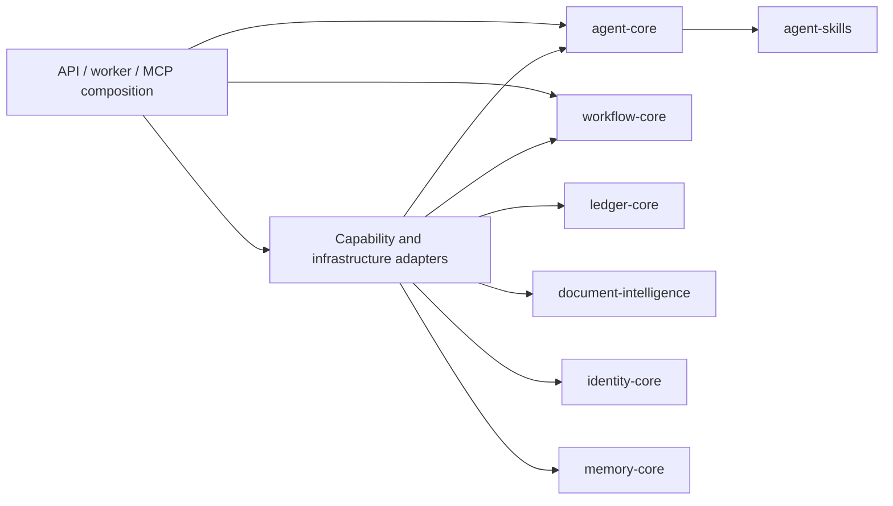

import AppArchitecture from '../img/app-architecture.avif';

# Proposed architecture

Status: proposed architecture and incremental migration plan under
[issue #3](https://github.com/Yudhyy/Klaudia/issues/3). The
[current architecture](overview.mdx) and [assessment](assessment.mdx) describe
source at `5a33e394748c9a1c7863488402acfa8b96780bd7`, checked on 2026-10-29.
The ownership and dependency rules below guide subsequent code PRs. The first
pure ledger-core package is now implemented; the rest of the package tree remains
a destination sketch. The outbound MCP client now belongs to application adapters.
Agent-owned capability requests and application translation adapters now remove
the agent's direct ledger dependency. The runtime and skills now have canonical
packages; application adapters own model-provider construction.
The overview and assessment distinguish these follow-ups
from their recorded baseline source.

Klaudia remains a modular monolith with one application release, a shared
PostgreSQL database, and separate API, extraction-worker and MCP processes.
The agent interprets requests and proposes actions. Deterministic backend code
authorizes, validates, calculates and commits financial effects. Module
interfaces and import checks should make that separation explicit.

Design reference: [Domain-Driven Hexagon](https://github.com/Sairyss/domain-driven-hexagon).
Use domain models where rules justify them, especially financial operations.
Straightforward application functions and typed contracts are sufficient for
simpler modules.

## Module ownership

| Module | Owns | Current implementation | Proposed package |
| --- | --- | --- | --- |
| Ledger | Exact financial calculations, catalogue/table rules, revisions, prepared operations, financial approval requirements and committed receipts | `mcp-ledger/ledger/`, with application catalogue/operation adapters | `ledger-core` |
| Agent runtime | Model-driven steps, tool selection, run context and continuation payloads | `packages/agent-core/src/agent_core/agent/` and `packages/agent-skills/src/agent_skills/`; `klaudia/core/` keeps compatibility imports | `agent-core` and `agent-skills` (implemented) |
| Documents | Ingestion, extraction, expected pages, saved outcomes and document lifecycle | `app/services/extraction/` and archive reads | `document-intelligence` |
| Identity | Accounts, credentials, authentication use cases and account access state | Auth routes/services and user methods in `AppDBClient` | `identity-core` |
| Workflow | Durable task identity/status, checkpoint persistence, exclusive task execution, resume coordination and human-decision routing | `app/services/workflow/` and durable orchestration in `main_chat.py` | `workflow-core` |
| Memory | Owner-scoped context documents, preferences, policy documents and their revisions | `app/services/memory/` | `memory-core` |

Ownership describes rules and interfaces, not a requirement to create every
package at once. The agent defines how to serialize and interpret its
continuation. Workflow stores that continuation and coordinates resumption
through a run capability supplied by composition. Memory policy documents
supply context; ledger code validates their financial use and commits effects.

HTTP, MCP, model clients, queues, storage clients and concrete persistence are
adapters. `services/api` is the proposed home for their composition and process
entrypoints. A future shared kernel contains only types with demonstrated
cross-module ownership. Internal ledger request models belong to ledger-core;
the separate `packages/contracts` sketch concerns generated client/transport
contracts.

### Approval and transaction responsibilities

Workflow presents an exact pending proposal, receives an authenticated human
decision, and routes it to ledger operations. Ledger binds the decision to the
stored proposal and enforces applicable approval, expiry, ownership, revision
and financial preconditions during execution. The agent can report or request
a decision; it cannot grant consent or replace the stored payload.

The current MCP interface exposes owned reads and denies mutations. Preserve
that contract during module moves; application checked tools remain the write
path. New transport entrypoints need their own authorization review.

Preserve the connection holding the durable task lock for its checked ledger
writes. Keep each effect and its receipt in one transaction, and reuse original
operation references on recovery. These requirements constrain adapter design;
a whole model run is not one database transaction. See the
[transaction assessment](assessment.mdx#preserve-transaction-ownership).

## Process composition

A composition root is the startup code that chooses implementations and owns
their lifecycle. Each process needs its own root, even when several processes
run the same image or import common construction functions.

| Process | Current startup | Proposed composition responsibility |
| --- | --- | --- |
| API | `app/main.py` and `KlaudiaContainer.create` | Build request services, agent/capability adapters, task/memory stores, model clients and the configured MCP client |
| Extraction worker | Taskiq hooks in `app/services/extraction/queue/state.py` | Build worker-local database, queue/cache, object-store and extraction clients |
| MCP host | `mcp-ledger/main.py` and `ledger.server.ledger_lifespan` | Configure transport/authentication, build the host-local ledger store and install the owned-read policy |

Share configuration types and provider construction where useful. Each process
creates and closes its own pools and clients. Core packages receive dependencies
through interfaces; importing them does not start another process or open a
connection. Recovery and scheduled entrypoints in the sketch remain future
work until corresponding behavior is implemented.


## Repository sketch

This tree retains longer-term options such as web/CLI clients, generated clients,
IronCalc, an event outbox and model hosting. Those options require separate
implementation scope and checks. The migration sequence below begins with the
existing pure ledger modules; it does not require those options, an ORM change,
or an event bus. The present asyncpg implementation and native decimal formulas
remain the starting point.

```text
klaudia/
├── .circleci/
│   ├── config.yml
│   └── continue.yml
│
├── .github/
│   ├── ISSUE_TEMPLATE/
│   └── pull_request_template.md
│
├── apps/                                 # web, mobile, cli/tui
│   ├── web/                              # next.js app router
│   │   ├── app/
│   │   │   ├── (marketing)/
│   │   │   │   ├── page.tsx
│   │   │   │   └── layout.tsx
│   │   │   ├── (auth)/
│   │   │   │   ├── login/page.tsx
│   │   │   │   ├── register/page.tsx
│   │   │   │   └── layout.tsx
│   │   │   ├── (workspace)/
│   │   │   │   ├── chat/page.tsx
│   │   │   │   ├── spreadsheets/page.tsx
│   │   │   │   ├── spreadsheets/[resource_id]/page.tsx
│   │   │   │   ├── documents/page.tsx
│   │   │   │   ├── documents/[document_id]/page.tsx
│   │   │   │   ├── approvals/page.tsx
│   │   │   │   ├── tasks/page.tsx
│   │   │   │   ├── memory/page.tsx
│   │   │   │   └── settings/page.tsx
│   │   │   ├── layout.tsx
│   │   │   └── globals.css
│   │   ├── features/
│   │   │   ├── auth/
│   │   │   │   ├── components/
│   │   │   │   ├── hooks/
│   │   │   │   └── api.ts
│   │   │   ├── chat/
│   │   │   │   ├── components/
│   │   │   │   ├── hooks/
│   │   │   │   └── api.ts
│   │   │   ├── ledger/
│   │   │   ├── documents/
│   │   │   ├── approvals/
│   │   │   ├── tasks/
│   │   │   └── memory/
│   │   ├── components/
│   │   │   ├── ui/
│   │   │   └── layout/
│   │   ├── lib/
│   │   │   ├── api-client.ts
│   │   │   ├── query-client.ts
│   │   │   ├── auth.ts
│   │   │   ├── env.ts
│   │   │   └── utils.ts
│   │   ├── providers/
│   │   ├── public/
│   │   ├── tests/
│   │   ├── next.config.ts
│   │   ├── package.json
│   │   ├── tsconfig.json
│   │   └── vitest.config.ts
│   │
│   ├── mobile/                           # expo / react native
│   │   ├── app/
│   │   │   ├── (tabs)/
│   │   │   │   ├── _layout.tsx
│   │   │   │   ├── index.tsx
│   │   │   │   ├── profile.tsx
│   │   │   │   └── sheet.tsx
│   │   │   ├── _layout.tsx
│   │   │   └── auth.tsx
│   │   ├── features/
│   │   │   ├── auth/
│   │   │   ├── chat/
│   │   │   ├── ledger/
│   │   │   ├── documents/
│   │   │   ├── approvals/
│   │   │   └── tasks/
│   │   ├── components/
│   │   │   └── ui/
│   │   ├── lib/
│   │   │   ├── api-client.ts
│   │   │   ├── auth-session.ts
│   │   │   ├── secure-storage.ts
│   │   │   └── env.ts
│   │   ├── constants/
│   │   ├── assets/
│   │   ├── tests/
│   │   ├── app.json
│   │   ├── package.json
│   │   └── tsconfig.json
│   │
│   └── cli/                              # rust cli/tui crate
│       ├── src/
│       │   ├── main.rs                   # entry point cli/tui
│       │   ├── app.rs                    # application state & event loop
│       │   ├── ui/                       # ratatui tui layouts & components
│       │   │   ├── mod.rs
│       │   │   ├── chat.rs
│       │   │   ├── ledger.rs
│       │   │   ├── documents.rs
│       │   │   └── components/
│       │   ├── client/                   # json-rpc 2.0/rest client
│       │   │   ├── mod.rs
│       │   │   ├── jsonrpc.rs
│       │   │   └── endpoints.rs
│       │   ├── config.rs                 # cli env / local auth config
│       │   └── error.rs
│       ├── tests/                        # integration / ui unit tests
│       │   └── cli_test.rs
│       ├── build.rs                      # cargo build script (generate rust types from contracts)
│       └── Cargo.toml                    # rust crate manifest
│
├── services/
│   └── api/                              # API, worker and MCP process entrypoints
│       ├── src/klaudia_api/
│       │   ├── __init__.py
│       │   ├── main.py
│       │   │
│       │   ├── interfaces/                   # inbound adapters
│       │   │   ├── __init__.py
│       │   │   ├── http/                     # fastapi rest adapter
│       │   │   │   ├── __init__.py
│       │   │   │   ├── app_factory.py
│       │   │   │   ├── dependencies.py
│       │   │   │   ├── error_handlers.py
│       │   │   │   ├── middleware.py
│       │   │   │   └── v1/
│       │   │   │       ├── __init__.py
│       │   │   │       ├── auth.py           # invoke identity_core use cases
│       │   │   │       ├── chat.py
│       │   │   │       ├── sessions.py
│       │   │   │       ├── tasks.py
│       │   │   │       ├── approvals.py
│       │   │   │       ├── memory.py
│       │   │   │       ├── resources.py
│       │   │   │       ├── spreadsheets.py
│       │   │   │       ├── documents.py
│       │   │   │       └── health.py
│       │   │   │       
│       │   │   ├── mcp/                     # mcp server adapter
│       │   │   │   ├── __init__.py
│       │   │   │   ├── host.py              # fastmcp host/transport
│       │   │   │   ├── registry.py          # tool registration
│       │   │   │   ├── auth.py
│       │   │   │   ├── policy.py
│       │   │   │   └── ledger/              # mcp-ledger
│       │   │   │       ├── __init__.py
│       │   │   │       └── server.py
│       │   │   │
│       │   │   └── workers/                 # taskiq / background entrypoints
│       │   │       ├── __init__.py
│       │   │       ├── broker.py
│       │   │       ├── extraction_worker.py
│       │   │       ├── recovery_worker.py
│       │   │       └── scheduled_worker.py
│       │   │
│       │   ├── adapters/                    # outbound infrastructure adapters
│       │   │   ├── __init__.py
│       │   │   ├── capabilities/             # implement consumer-owned ports
│       │   │   │   ├── agent_ledger.py
│       │   │   │   ├── agent_documents.py
│       │   │   │   ├── agent_memory.py
│       │   │   │   ├── workflow_agent.py
│       │   │   │   └── workflow_ledger.py
│       │   │   ├── llm/
│       │   │   │   ├── __init__.py
│       │   │   │   ├── model_factory.py
│       │   │   │   ├── openai_compatible_adapter.py
│       │   │   │   ├── gemini_vertex_adapter.py 
│       │   │   │   ├── anthropic_adapter.py 
│       │   │   │   └── fake_model_adapter.py
│       │   │   ├── mcp_client/               # outbound MCP client
│       │   │   │   └── tool_registry.py
│       │   │   ├── events/
│       │   │   │   ├── in_memory_event_publisher.py
│       │   │   │   └── postgres_outbox_event_publisher.py
│       │   │   ├── persistence/
│       │   │   │   ├── __init__.py
│       │   │   │   ├── database.py
│       │   │   │   ├── unit_of_work.py
│       │   │   │   ├── postgres_memory_repository.py
│       │   │   │   ├── postgres_checkpoint_repository.py
│       │   │   │   ├── postgres_ledger_repository.py
│       │   │   │   ├── postgres_operation_repository.py
│       │   │   │   └── postgres_approval_repository.py
│       │   │   ├── documents/
│       │   │   │   ├── __init__.py
│       │   │   │   ├── object_store/
│       │   │   │   │   └── s3_object_store.py
│       │   │   │   ├── kie/
│       │   │   │   │   ├── __init__.py
│       │   │   │   │   ├── openai_compatible_vision_kie_adapter.py
│       │   │   │   │   ├── gemini_vertex_kie_adapter.py 
│       │   │   │   │   ├── kie_factory.py
│       │   │   │   │   └── fake_kie_adapter.py
│       │   │   │   ├── queue/
│       │   │   │   │   └── redis_queue_adapter.py
│       │   │   │   └── cache/
│       │   │   │       └── redis_dedup_cache.py
│       │   │   ├── formulas/
│       │   │   │   ├── __init__.py
│       │   │   │   └── ironcalc_adapter.py
│       │   │   ├── observability/        # vendor implementations
│       │   │   │   ├── __init__.py
│       │   │   │   ├── tracer_factory.py
│       │   │   │   └── langfuse_tracer.py
│       │   │   └── guardrails/
│       │   │       ├── __init__.py
│       │   │       ├── rule_guardrail_adapter.py
│       │   │       └── llm_guardrail_adapter.py
│       │   │
│       │   ├── composition/              # one root per process; shared providers
│       │   │   ├── __init__.py
│       │   │   ├── api.py
│       │   │   ├── extraction_worker.py
│       │   │   ├── mcp.py
│       │   │   ├── providers.py
│       │   │   └── settings.py
│       │   └── observability/            # cross-cutting application concern
│       │       ├── __init__.py
│       │       ├── logging.py            # structured json logs
│       │       ├── tracing.py            # trace factory + run metadata        
│       │       └── correlation.py        # request/session/task/operation context
│       │
│       ├── migrations/                      # versioned alembic migrations
│       │   ├── versions/
│       │   ├── env.py
│       │   └── alembic.ini
│       ├── config/
│       │   ├── models.yaml
│       │   └── models.schema.json
│       ├── tests/
│       │   ├── unit/
│       │   ├── integration/
│       │   └── conftest.py
│       ├── Dockerfile
│       └── pyproject.toml
│
├── packages/
│   ├── identity-core/
│   │   ├── src/identity_core/
│   │   │   ├── __init__.py
│   │   │   ├── domain/
│   │   │   │   ├── __init__.py
│   │   │   │   ├── user.py
│   │   │   │   ├── session.py
│   │   │   │   ├── credential.py
│   │   │   │   ├── role.py
│   │   │   │   ├── permission.py
│   │   │   │   └── ports/
│   │   │   │       ├── __init__.py
│   │   │   │       ├── user_repository.py
│   │   │   │       ├── session_repository.py
│   │   │   │       ├── password_hasher_port.py
│   │   │   │       └── token_issuer_port.py       
│   │   │   └── application/
│   │   │       ├── __init__.py
│   │   │       ├── register_user.py
│   │   │       ├── authenticate.py
│   │   │       ├── refresh_session.py
│   │   │       └── authorize.py
│   │   ├── tests/
│   │   └── pyproject.toml
│   │
│   ├── shared-kernel/                    # zero infrastructure dependencies
│   │   ├── src/shared_kernel/
│   │   │   ├── __init__.py
│   │   │   ├── ids.py
│   │   │   ├── money.py
│   │   │   ├── decimal_value.py
│   │   │   ├── revision.py
│   │   │   ├── ownership.py
│   │   │   ├── operation_ref.py
│   │   │   ├── result.py
│   │   │   ├── errors.py
│   │   │   ├── clock.py
│   │   │   └── pagination.py
│   │   ├── tests/
│   │   └── pyproject.toml
│   │
│   ├── contracts/                        # openapi + generated clients
│   │   ├── openapi/
│   │   │   └── klaudia.json              # generated and committed
│   │   ├── generated/
│   │   │   ├── typescript/
│   │   │   │   ├── schema.d.ts
│   │   │   │   └── index.ts
│   │   │   ├── python/
│   │   │   │   └── README.md
│   │   │   └── rust/                     # generated rust dtos / structs
│   │   │       ├── Cargo.toml
│   │   │       └── src/
│   │   │           └── lib.rs
│   │   ├── scripts/                      # drift Check
│   │   │   ├── export-openapi.mjs
│   │   │   ├── generate-clients.mjs
│   │   │   └── generate-rust-dto.sh
│   │   ├── package.json
│   │   └── tsconfig.json
│   │
│   ├── agent-core/                       # agent domain, use cases, ports
│   │   ├── src/agent_core/
│   │   │   ├── __init__.py
│   │   │   ├── domain/
│   │   │   │   ├── __init__.py
│   │   │   │   ├── agent_run.py
│   │   │   │   ├── agent_step.py
│   │   │   │   ├── run_context.py
│   │   │   │   ├── message.py
│   │   │   │   ├── attachment.py
│   │   │   │   ├── tool_call.py
│   │   │   │   ├── tool_result.py
│   │   │   │   ├── tool_spec.py
│   │   │   │   ├── skill.py
│   │   │   │   ├── guardrail.py
│   │   │   │   ├── checkpoint.py             # agent continuation format
│   │   │   │   ├── budget.py
│   │   │   │   └── ports/
│   │   │   │       ├── __init__.py
│   │   │   │       ├── model_port.py
│   │   │   │       ├── tool_port.py
│   │   │   │       ├── memory_port.py
│   │   │   │       ├── document_port.py         # capability-level
│   │   │   │       ├── ledger_port.py
│   │   │   │       ├── approval_port.py         # report required human decision
│   │   │   │       ├── checkpoint_port.py
│   │   │   │       └── event_publisher_port.py  # publish agent lifecycle events
│   │   │   ├── application/
│   │   │   │   ├── __init__.py
│   │   │   │   ├── start_chat_run.py
│   │   │   │   ├── continue_chat_run.py
│   │   │   │   ├── verify_response.py
│   │   │   │   └── rebuild_context.py
│   │   │   └── tools/
│   │   │       ├── __init__.py
│   │   │       ├── registry.py
│   │   │       ├── policy.py
│   │   │       └── schemas.py
│   │   ├── tests/
│   │   └── pyproject.toml
│   │
│   ├── agent-skills/                     # versioned skills + prompts
│   │   ├── skills/
│   │   │   ├── decimal-formulas/
│   │   │   │   ├── SKILL.md
│   │   │   │   └── tests.yaml
│   │   │   ├── financial-execution/
│   │   │   │   ├── SKILL.md
│   │   │   │   └── tests.yaml
│   │   │   ├── policy-reconciliation/
│   │   │   │   ├── SKILL.md
│   │   │   │   └── tests.yaml
│   │   │   ├── resource-discovery/
│   │   │   │   ├── SKILL.md
│   │   │   │   └── tests.yaml
│   │   │   ├── schema-inspection/
│   │   │   │   ├── SKILL.md
│   │   │   │   └── tests.yaml
│   │   │   ├── table-append/
│   │   │   │   ├── SKILL.md
│   │   │   │   └── tests.yaml
│   │   │   ├── table-authoring/
│   │   │   │   ├── SKILL.md
│   │   │   │   └── tests.yaml
│   │   │   └── table-calculation/
│   │   │       ├── SKILL.md
│   │   │       └── tests.yaml
│   │   ├── src/agent_skills/
│   │   │   ├── __init__.py
│   │   │   ├── loader.py
│   │   │   ├── registry.py
│   │   │   ├── validator.py
│   │   │   └── models.py
│   │   ├── tests/
│   │   └── pyproject.toml
│   │
│   ├── ledger-core/                          # deterministic accountant domain
│   │   ├── src/ledger_core/
│   │   │   ├── __init__.py
│   │   │   ├── domain/
│   │   │   │   ├── __init__.py
│   │   │   │   ├── resource.py
│   │   │   │   ├── catalogue.py
│   │   │   │   ├── spreadsheet.py
│   │   │   │   ├── sheet.py
│   │   │   │   ├── table.py
│   │   │   │   ├── row.py
│   │   │   │   ├── cell.py
│   │   │   │   ├── typed_value.py
│   │   │   │   ├── typed_schema.py
│   │   │   │   ├── formula.py
│   │   │   │   ├── calculation.py
│   │   │   │   ├── financial_record.py
│   │   │   │   ├── accounting_policy.py      # financial policy interpretation
│   │   │   │   ├── operation.py
│   │   │   │   ├── operation_status.py
│   │   │   │   ├── receipt.py
│   │   │   │   ├── approval.py               # financial operation approval
│   │   │   │   └── events.py
│   │   │   ├── application/
│   │   │   │   ├── __init__.py
│   │   │   │   ├── search_resources.py
│   │   │   │   ├── inspect_resource.py
│   │   │   │   ├── query_financial_data.py
│   │   │   │   ├── calculate.py
│   │   │   │   ├── prepare_append.py
│   │   │   │   ├── prepare_table_authoring.py
│   │   │   │   ├── approve_operation.py
│   │   │   │   ├── execute_operation.py
│   │   │   │   ├── recover_operation.py      # original ledger reference/receipt
│   │   │   │   └── issue_receipt.py
│   │   │   └── ports/
│   │   │       ├── __init__.py
│   │   │       ├── ledger_repository.py
│   │   │       ├── catalogue_repository.py
│   │   │       ├── operation_repository.py
│   │   │       ├── approval_repository.py
│   │   │       ├── formula_engine_port.py
│   │   │       └── event_publisher_port.py #publish ledger domain events
│   │   ├── tests/
│   │   └── pyproject.toml
│   │
│   ├── workflow-core/                    # durable task and decision coordination
│   │   ├── src/workflow_core/
│   │   │   ├── __init__.py
│   │   │   ├── task.py
│   │   │   ├── checkpoint.py             # stored continuation and revisions
│   │   │   ├── application/
│   │   │   │   ├── start_task.py
│   │   │   │   ├── resume_task.py
│   │   │   │   ├── approve_pending_operation.py
│   │   │   │   └── reject_pending_operation.py
│   │   │   └── ports/
│   │   │       ├── task_store.py
│   │   │       ├── agent_run.py
│   │   │       └── operation_decisions.py
│   │   ├── tests/
│   │   └── pyproject.toml
│   │
│   ├── memory-core/                      # owner-scoped context and revisions
│   │   ├── src/memory_core/
│   │   │   ├── __init__.py
│   │   │   ├── documents.py
│   │   │   ├── policy.py                 # stored policy document contract
│   │   │   ├── application/
│   │   │   │   ├── read_document.py
│   │   │   │   └── edit_document.py
│   │   │   └── ports/
│   │   │       └── document_repository.py
│   │   ├── tests/
│   │   └── pyproject.toml
│   │
│   └── document-intelligence/              # ingestion + extraction domain
│       ├── src/document_intelligence/
│       │   ├── __init__.py
│       │   ├── domain/
│       │   │   ├── __init__.py
│       │   │   ├── document.py
│       │   │   ├── page.py
│       │   │   ├── extraction_job.py
│       │   │   ├── extraction_result.py
│       │   │   ├── field_prediction.py
│       │   │   ├── confidence.py
│       │   │   └── ports/
│       │   │       ├── __init__.py
│       │   │       ├── object_store_port.py
│       │   │       ├── kie_model_port.py
│       │   │       ├── queue_port.py
│       │   │       ├── dedup_cache_port.py
│       │   │       └── document_repository_port.py
│       │   └── application/
│       │       ├── __init__.py
│       │       ├── ingest_document.py
│       │       ├── split_pdf.py
│       │       ├── extract_fields.py
│       │       ├── normalize_extraction.py
│       │       ├── deduplicate_document.py
│       │       └── get_extraction_progress.py
│       ├── tests/
│       └── pyproject.toml
│
├── infra/
│   ├── docker/
│   │   ├── api.Dockerfile
│   │   ├── worker.Dockerfile
│   │   └── web.Dockerfile
│   └── compose/
│       ├── docker-compose.yml
│       ├── docker-compose.dev.yml
│       └── docker-compose.test.yml
│
├── evals/
│   ├── datasets/
│   │   ├── capability/
│   │   ├── guardrails/
│   │   ├── financial/                    # MBABench
│   │   ├── extraction/
│   │   ├── reconciliation/
│   │   └── hostile/
│   ├── runners/
│   │   ├── smoke.py
│   │   ├── capability.py
│   │   ├── financial.py
│   │   ├── guardrails.py
│   │   └── regression.py
│   ├── baselines/
│   │   ├── smoke.json
│   │   ├── financial.json
│   │   └── guardrails.json
│   ├── reports/                          # gitignored
│   └── README.md
│
├── docs/
│   ├── .mintignore
│   ├── docs.json
│   ├── favicon.ico
│   ├── favicon.svg
│   ├── style.css
│   ├── README.md
│   ├── _snippets/
│   ├── static/
│   │   └── img/
│   └── en/
│       ├── 01-getting-started/
│       ├── 02-installation/
│       ├── 03-configuration/
│       ├── 04-using-klaudia/
│       ├── 05-development/
│       │   ├── img/
│       │   ├── contributing/
│       │   │   ├── issue-workflow.mdx
│       │   │   └── roadmap.mdx
│       │   ├── architecture/
│       │   │   ├── overview.mdx
│       │   │   ├── assessment.mdx
│       │   │   ├── target.mdx
│       │   │   ├── tech-stack.mdx
│       │   │   ├── gateway.mdx
│       │   │   ├── boundaries.mdx
│       │   │   ├── agent-runtime.mdx
│       │   │   ├── ledger-runtime.mdx
│       │   │   ├── document-pipeline.mdx
│       │   │   ├── database.mdx
│       │   │   ├── auth.mdx
│       │   │   ├── directories.mdx
│       │   │   ├── contracts.mdx
│       │   │   └── decisions/
│       │   │       ├── 0001-hexagonal-modular-monolith.mdx
│       │   │       ├── 0002-openapi-contract.mdx
│       │   │       └── 0003-ironcalc-as-formula-engine.mdx
│       │   └── research/                # training/fine-tuning, modeling, comparison, etc...
│       │       ├── models/
│       │       ├── papers/
│       │       ├── experiments/
│       │       ├── evals/
│       │       └── design/
│       └── 06-policies/
│
├── scripts/
│   ├── export_openapi.py
│   ├── seed_dev_data.py
│   ├── run_worker.sh
│   └── migrate.sh
│
├── tests/
│   ├── architecture/
│   └── e2e/
│       ├── datasets/                    # golden dataset versioned (20–100 real cases)
│       ├── runners/
│       └── conftest.py
│
├── .env.template
├── .gitignore
├── .gitattributes
├── .gitmessage
├── .dockerignore
├── .python-version
├── pnpm-workspace.yaml
├── pnpm-lock.yaml
├── Cargo.lock
├── pyproject.toml                        # uv workspace root
├── uv.lock
├── README.md
├── AGENTS.md
├── CONTRIBUTING.md
├── CODE_OF_CONDUCT.md
├── COMPLIANCE.md
├── SECURITY.md
├── THIRD_PARTY_NOTICES.md
├── LICENSE
├── Makefile
└── turbo.json                            # optional js task orchestration
```

## Dependency rules

### Current implementation

`app` composes agent protocols with concrete ledger, document, workflow and
memory implementations. The agent uses its own capability request shapes and
LangChain model/tool types. At the recorded baseline, its distribution also
contains the FastMCP client adapter and depends on `mcp-ledger`. The recorded
[architecture checks](https://github.com/Yudhyy/Klaudia/blob/5a33e394748c9a1c7863488402acfa8b96780bd7/tests/unit/test_architecture_imports.py)
enforce specific rules: ledger does not import app/agent/config, the agent does
not import app/config, and agent core does not import ledger persistence.

### First package extraction

The current source implements the first ledger-core slice with pure contracts
and deterministic calculations in `packages/ledger-core`. At that extraction,
the agent declared `ledger-core` and FastMCP directly instead of depending on
`mcp-ledger`. The dependency graph at that extraction was:

```text
agent runtime --------------------> ledger-core public contracts/helpers
legacy ledger compatibility paths -> ledger-core canonical definitions
ledger execution and storage -----> ledger-core
application adapters -------------> agent protocols and ledger implementations
```

The DTO/helper dependency was transitional. Core code must not import back into
the old ledger package or depend on database, MCP, HTTP adapters or settings.
Keep the existing `OperationExecutor`, `CatalogueReader` and
`AuthoringReader` protocols; isolating their imported types does not require
changing their behavior.

This extraction makes ledger-core independently installable. Separating the
agent's remaining infrastructure is independent work.

### MCP client separation

The current outbound client lives in `app/adapters/mcp_client/tool_registry.py`.
The application declares FastMCP directly; the agent no longer declares FastMCP
or MCP and its wheel excludes the client. The old `klaudia.interfaces` client
imports are removed. Client authorization, supported transports and errors
retain their behavior. At that stage, the agent retained LangChain and provider
libraries. The runtime/skills extraction below moves provider construction.
Independent agent-wheel tests check installed execution and all packaged skills
with MCP absent.

### Capability contract separation

Agent-owned requests and expected failures now live under
`packages/agent-core/src/agent_core/agent/ports/`. Application adapters under `app/adapters/agent/`
translate catalogue reads, append/authoring/typed proposals and expected failures
to and from canonical ledger contracts. Backend code keeps financial validation,
exact calculations, ownership, approval and receipt rules. The operation adapter
uses the executor supplied for the run, including the existing durable task
connection. HTTP services retain their canonical ledger request and error types.

Agent code and its manifest no longer import or declare ledger or ledger-core.
Import checks enforce that rule; installed-wheel checks run all ledger tool
families and load skills with both ledger distributions absent. Complete frozen
tool/continuation fixtures protect release compatibility. This settles the
agent-to-ledger boundary; it does not extract workflow, document, memory or
identity packages. The next extraction moves model-provider construction.

### Runtime, skills and provider separation

`packages/agent-core` owns the existing agent module structure under
`agent_core.agent`. `packages/agent-skills` owns the registry and the single copy
of each versioned procedure under `agent_skills`. The runtime retains its prompt
and injected LangChain model/tool contract. Application callers import these
canonical packages. Legacy runtime and registry imports under `klaudia.core`
re-export the same definitions.

The provider factory moved to `app/adapters/llm/model_factory.py`; its aliases,
endpoint/key checks, thinking settings and construction failures stay unchanged.
The old `klaudia.core.agent.llm` path is removed. The root application declares
provider libraries and its existing TOON context encoder dependency. Neither
canonical agent package imports application code, ledger, MCP, database clients
or concrete model providers. The skills package also has no runtime dependency.

Installed-wheel checks exercise scripted agent tools and load exact skill bytes
with those dependencies absent. The compatibility wheel checks object identity.
Workspace membership, Docker manifest copies and backend CI selection include
both packages. This step does not move process entrypoints or storage modules.

### Final module interfaces

The intended final graph uses consumer-owned capability ports. Concrete
adapters import those ports and the provider module, translate requests/results,
and are supplied by process composition. In this diagram, arrows mean imports,
not the direction of runtime calls.



Agent core ultimately has no direct dependency on ledger, documents, identity,
memory or workflow packages. Workflow invokes a supplied run capability and
operation-decision capability rather than importing their implementations.
Other core modules keep their own rules and receive infrastructure through
their interfaces. Shared-kernel types are an allowed dependency when their
ownership is actually shared; a universal DTO or repository package would hide
the ownership decisions.

Moving to this graph is a separate code slice after the pure extraction.
Adapters preserve schemas, serialized continuation/operation payloads, error
behavior and exact operation identities. They translate representations while
ledger retains financial validation. Client apps consume generated transport
contracts when those clients are implemented; internal Python domain models do
not become client wire contracts by default.

## Migration sequence

| Stage | Deliverable | Completion evidence |
| --- | --- | --- |
| Implemented at the reviewed source | Scoped MCP reads, saved queued outcomes, isolated proposal imports and narrow dependency checks | Source and existing regression tests linked in the [assessment](assessment.mdx) |
| Implemented first extraction | Installable pure `packages/ledger-core` slice with compatibility re-exports | `tests/packaging/test_ledger_core.py`, compatibility/import checks and existing calculation/execution/recovery suites; workspace/Docker/CI paths include the package |
| Implemented transport separation | Outbound MCP client in application adapters; agent distribution drops MCP dependencies | Independent installed-agent/skill check, package-wide import rule and existing client/authorization regressions |
| Implemented capability separation | Agent-owned document, memory, policy and ledger contracts with application adapters | Frozen tool/error/continuation contracts, independent installed tools, import checks and execution/recovery regressions |
| Implemented runtime separation | Agent runtime/skills packages and application-owned provider construction | Independent runtime, skills and compatibility wheel checks; frozen schemas/continuations; process startup, Docker and CI selection checks |
| Module by module | Workflow, memory, documents and identity packages with their adapters | Owned entrypoints, durable/owner-isolation regressions and process startup checks for each moved module |
| As consumers are ready | API/worker/MCP entrypoints and infrastructure relocated into the proposed service layout | Installed imports and startup for all three processes; Docker, CI, commands and contributor docs match the new paths |

Use the [first-extraction scope and acceptance criteria](assessment.mdx#first-extraction-installable-ledger-core)
as the contract retained by the first code slice. Its implementation keeps the
existing pure module structure; the full domain/application tree above is a
later design option. Test commands/results belong to the code PR; the presence
of CI configuration does not establish a remote pass.
Identity/schema-changing work must define upgrade ownership before moving stores
and remain coordinated with [issue #9](https://github.com/Yudhyy/Klaudia/issues/9).
The ledger's standalone initialization remains supported.

Each slice moves a working responsibility with its callers, metadata, tests and
entrypoints. Preserve public behavior during package moves. Record deliberate
behavior changes separately with their own acceptance criteria. Add remaining
clients, event delivery, model hosting, evaluation gates and optional engines
when their implementation is selected and independently verified.

## Longer-term deployment sketch

The following sketch illustrates possible capabilities. PostgreSQL schema names,
Redis locks, a gateway, model hosting and IronCalc here are proposed, not claims
about the reviewed runtime. The process table above describes the startup
responsibilities to preserve during migration.

```text
                                    clients
                           mobile / web / api / cli
                                       │
                                       ▼
                         ┌──────────────────────────┐
                         │ load balancer / gateway  │
                         └─────────────┬────────────┘
                                       │
                                       ▼

                    ╔════════════════════════════════════════╗
                    ║      stateless application plane       ║
                    ╚════════════════════════════════════════╝

                         ┌──────────────────────────┐
                         │       klaudia api        │
                         │        fastapi           │
                         │                          │
                         │ auth / jwt / acl         │
                         │ rate limits              │
                         │ request validation       │
                         │ tracing                  │
                         └─────────────┬────────────┘
                                       │
                                       ▼
                         ┌──────────────────────────┐
                         │    thin orchestrator     │
                         │                          │
                         │ session reconstruction   │
                         │ attachment routing       │
                         │ approval routing         │
                         │ task resume              │
                         └─────────────┬────────────┘
                                       │
                                       ▼
                         ┌──────────────────────────┐
                         │      main agent          │
                         │                          │
                         │ intent / planning        │
                         │ tool selection           │
                         │ clarification            │
                         │ response generation      │
                         └─────────────┬────────────┘
                                       │
                     ┌─────────────────┼──────────────────┐
                     │                 │                  │
                     ▼                 ▼                  ▼
              ┌─────────────┐   ┌─────────────┐   ┌──────────────┐
              │   skills    │   │   context   │   │ task runtime │
              │             │   │   broker    │   │              │
              │ procedures  │   │             │   │ checkpoint   │
              │ policies    │   │ catalogue   │   │ op history   │
              │ workflows   │   │ memory docs │   │ budgets      │
              └─────────────┘   │ working set │   └──────────────┘
                                └──────┬──────┘
                                       │
                                       ▼
                              ┌────────────────┐
                              │  tool facade   │
                              │                │
                              │ search         │
                              │ inspect        │
                              │ query          │
                              │ calculate      │
                              │ mutate         │
                              │ memory         │
                              │ documents      │
                              └───────┬────────┘
                                      │
                                      ▼

              ╔════════════════════════════════════════════╗
              ║       deterministic financial runtime      ║
              ╚════════════════════════════════════════════╝

                  ┌─────────────────────────────────────┐
                  │       deterministic core            │
                  │                                     │
                  │ resource resolver / catalogue       │
                  │ query engine                        │
                  │ finance engine                      │
                  │ accounting invariants               │
                  │ operation engine                    │
                  │ formula runtime                     │
                  └──────────────────┬──────────────────┘
                                     │
                    ┌────────────────┼──────────────────┐
                    │                │                  │
                    ▼                ▼                  ▼

               query engine    finance engine     formula engine
                                                        │
                                                        ▼
                                                  ┌───────────┐
                                                  │ ironcalc  │
                                                  │ adapter   │
                                                  └───────────┘

                                     │
                                     ▼
                    ┌────────────────────────────────┐
                    │    transaction coordinator     │
                    │                                │
                    │ authorization                  │
                    │ revision check                 │
                    │ preconditions                  │
                    │ idempotency                    │
                    │ approval                       │
                    │ mutation                       │
                    │ formula recalc                 │
                    │ accounting validation          │
                    │ postconditions                 │
                    │ operation receipt              │
                    └───────────────┬────────────────┘
                                    │
                                    ▼

              ╔════════════════════════════════════════════╗
              ║               stateful plane               ║
              ╚════════════════════════════════════════════╝

                         ┌─────────────────────────┐
                         │       postgres          │
                         │                         │
                         │ auth.*                  │
                         │ ledger.*                │
                         │ catalogue.*             │
                         │ memory.*                │
                         │ workflow.*              │
                         │ audit.*                 │
                         └─────────────────────────┘

                   ┌──────────────┐    ┌──────────────┐
                   │    redis     │    │      s3      │
                   │              │    │              │
                   │ queue        │    │ documents    │
                   │ cache        │    │ uploads      │
                   │ locks        │    │ source files │
                   └──────────────┘    └──────────────┘


              ╔════════════════════════════════════════════╗
              ║               model plane                  ║
              ╚════════════════════════════════════════════╝

                        ┌───────────────────────┐
                        │    model gateway      │
                        │                       │
                        │ provider routing      │
                        │ retries/timeouts      │
                        │ tracing               │
                        │ token accounting      │
                        └───────────┬───────────┘
                                    │
                   ┌────────────────┼────────────────┐
                   │                │                │
                   ▼                ▼                ▼

              hosted llm      self-hosted llm     extraction
              deepseek etc.       vllm          vlm/kie model
                                     │
                                    gpu
```
