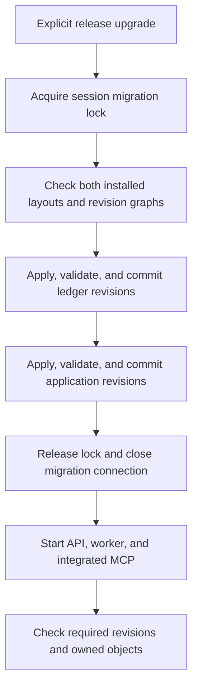

# Database migrations

Use this guide to prepare and release a schema change. The
[database architecture](../architecture/database.mdx) describes ownership and
runtime behavior. [ADR 0001](../architecture/decisions/0001-database-migration-schema.mdx)
explains the design and its tradeoffs.

## Setup and release order



Both histories share one dedicated migration connection and one session advisory
lock. The runner checks both starting layouts before it writes either version
table. Each transactional revision commits its operations and version update
together. If an application revision fails, the completed ledger revision can
remain recorded. Rollout stops until the application history succeeds.

From the repository root, with the intended `DATABASE_URL` set:

```bash
uv run python -m app.adapters.persistence upgrade
uv run python -m app.adapters.persistence check
```

`check` opens a read-only connection and applies no migrations. Both commands
accept `--database-url` for an explicit target. Keep credentials out of shared
terminal logs and shell history.

Docker Compose runs the upgrade in the one-shot `migrate` service. API and worker
startup depend on its successful completion. Before the first cutover, take a
tested backup and stop the old API and workers: the old release can still run
schema SQL at startup. Start the new processes after both histories pass.

### Standalone ledger

The installed `ledger-postgres` package exposes the same ledger history without
application or MCP imports:

```bash
python -m ledger_postgres.migrations upgrade
python -m ledger_postgres.migrations check
```

The former `python -m ledger.migrations` entrypoint remains supported when the
MCP distribution is installed. Root `alembic.ini` selects the canonical ledger
history under `packages/ledger-postgres/src/ledger_postgres/migrations/`.

`LedgerStore.connect()` retains automatic standalone setup through the canonical
ledger runner and its lock. It does not create application tables. Integrated
composition uses `connect_existing()`. Its MCP child receives
`LEDGER_SCHEMA_MODE=check`; independently deployed integrated MCP hosts must set
the same mode. Standalone MCP defaults to `initialize`. Unknown modes fail startup.

Adding application objects to a versioned ledger-only database preserves ledger
records and the recorded ledger revision.

## Existing databases and adoption

The initial baselines target PostgreSQL 16 and retain current names, types,
defaults, constraints, indexes, generated expressions, functions, and triggers.
Adoption compares PostgreSQL catalog definitions with a frozen schema contract,
including identity sequence settings and index validity. Table names and an empty
autogenerated diff alone do not prove compatibility.

| Starting state | Action |
| --- | --- |
| Blank owned object set | Run the baseline. A preinstalled `pg_trgm` extension is allowed. |
| Complete unversioned current layout | Verify equivalence, stamp the fixed baseline revision, then run pending revisions. |
| Supplied pre-revision ledger-sheet layout | Check the known layout, retain its grid and identity, adopt workbooks as owner `0`, and install missing ledger objects and guards. |
| Complete unversioned ledger layout without its workspace foreign key | Check this known shape, adopt missing workbook rows, then restore the foreign key through the baseline. |
| Known recorded revision | Verify that revision's frozen layout, then apply later revisions in order. |
| Partial, changed, or unknown owned layout or revision | Fail before stamping or starting services. Repair the specific mismatch. |

The initial fixed revisions are `ledger_0001` and `app_0001`. Alembic's
[`stamp`](https://alembic.sqlalchemy.org/en/latest/api/commands.html#alembic.command.stamp)
records a revision without applying migrations. Only the checked adoption path
can use it. Do not stamp `head` to conceal incomplete work.

Each history filters reflection and comparison to its owned objects. Application
tables cannot become ledger drop candidates, or ledger tables application drop
candidates. Unowned tables remain outside both histories.

### Retained legacy objects

Older installations can contain `pending_approval`, `memory_history`, and
`memory_message`. The current runtime does not use these tables. Some databases
also have a nullable `ledger_table_operation.request JSONB` column; current
operations use `request_payload TEXT`. Adoption recognizes the supported legacy
column and leaves it intact. Blank baselines omit it.

The optional `vector` extension can remain from earlier memory storage. Current
memory uses revisioned context documents and needs no embedding extension.
Neither history removes unowned tables or optional extensions. Legacy removal
needs a separate reviewed revision after checking contents and dependencies.
Preserve current approvals, checkpoints, operation payloads, references, and
receipts during that work.

The application retains its existing development-user seed and startup user
sequence repair. Adoption does not rewrite credentials or serialized operations.

## Authoring configuration

Use the root `alembic.ini` with `-n application` or `-n ledger`. Its named
sections select the histories; its defaults set UTC filenames and its generation
hook runs Ruff. Each environment owns `env.py`, `script.py.mako`, and `versions/`.
Installed checks and upgrades use programmatic configuration and need no `.ini`
file or repository checkout. Author new revisions from the source checkout.

Filenames use `YYYY-MM-DD-HHMM_slug.py`. Headers contain the summary, Revision ID,
Revises, and Create Date. The revision graph determines execution order; dates
help readers browse files. Baseline IDs stay `app_0001` and `ledger_0001`.

## Author the next revision

Set `DATABASE_URL` to a current disposable database for autogeneration and checks.
Initialize that database through the release command first. Update the owner's
metadata, then generate its candidate revision with the standard CLI:

```bash
uv run alembic -n application revision --autogenerate -m "add document index"
uv run alembic -n ledger revision --autogenerate -m "add sheet notes"
```

Choose the history that owns the change. The two examples are alternatives.
Manual revision generation and file inspection need no database connection:

```bash
uv run alembic -n ledger revision -m "add ledger trigger"
uv run alembic -n application heads
uv run alembic -n ledger history
```

Autogeneration opens a dedicated read-only connection with the original DSN and
the shared migration lock. It uses the selected owner's metadata and filters;
it creates a candidate file without applying or stamping it. The command rejects
blank, unknown, outdated, or busy database targets. Inspect the candidate before
use: generated operations do not prove data safety or complete PostgreSQL object
coverage.

Keep published baselines fixed. Complete a later schema change as follows:

1. Generate the candidate, review its operations and predecessor, and keep the
   histories independent. Explicitly review data changes, locks and recovery.
2. Add the expected frozen schema contract as `<revision_id>.json` in the
   migration environment directory and update the history's required revision.
   Review the contract diff with the migration. Do not copy the old contract
   unchanged or relax validation to make a candidate pass.
3. Test the change from the preceding revision in a disposable database. Check
   populated records, repeat upgrades, failure recovery, metadata filters, and
   the final model/schema comparison:

   ```bash
   uv run alembic -n application check
   uv run alembic -n ledger check
   ```
4. Ship the revision with its runtime and run the release command before starting
   processes that require the new schema.

`alembic check` shares the read-only authoring path. Raw `alembic upgrade`,
`downgrade`, and `stamp` remain blocked; schema writes must use the coordinated
release entrypoints described above. Complete and verify one candidate before
starting the next, since the required revision, schema contract and script graph
must agree.

An uncommitted candidate that has never been applied can be discarded and
generated again after correcting the model. Also remove its unshipped contract
and restore the preceding required revision if those were already changed. If
the candidate reached a disposable test database, recreate that database at the
preceding revision before regeneration. A shared or published revision needs a
new forward revision; do not replace its history.

Alembic's `on_version_apply` callback checks each resulting schema before its
transaction commits. A session lock spans revision commits. A concurrent runner
exits with a busy error; it can retry after the active connection closes.

The initial baselines use transactional DDL. Interrupted revisions roll back and
can run again. Completed earlier histories remain recorded. Baseline downgrades
reject destructive removal; restore a verified backup with the matching release
when rollback requires it.

Future revisions with nontransactional DDL must define preconditions,
postconditions, and repair steps. For example, failed `CREATE INDEX CONCURRENTLY`
can leave an invalid index. Catalog checks reject that state before adoption or
retry. Check the definition and cause, repair or remove that failed index, then
rerun the revision. Never stamp over it. See
[PostgreSQL concurrent index recovery](https://www.postgresql.org/docs/16/sql-createindex.html#SQL-CREATEINDEX-CONCURRENTLY).

## Verification

Migration tests create disposable databases on an isolated PostgreSQL server.
They do not reset development stores. CircleCI runs them in a dedicated PostgreSQL
job. Application persistence, ledger migrations, tests, manifests, and lockfile
changes already select backend checks.

```bash
uv run pytest tests/unit/test_migration_metadata.py -q
uv run pytest tests/integration/migrations -q
uv run pytest tests/packaging -q
```

Behavior checks cover authenticated routes, task locks, exact approval and receipt
recovery, process interruption, typed-cell guards, and atomic financial writes.
See the [test guide](https://github.com/Yudhyy/Klaudia/blob/development/tests/e2e/README.md)
for service and live-model checks. CI configuration defines the checks; each
release still needs results from its own revision.
