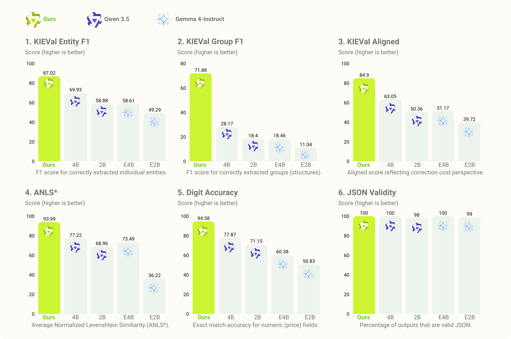
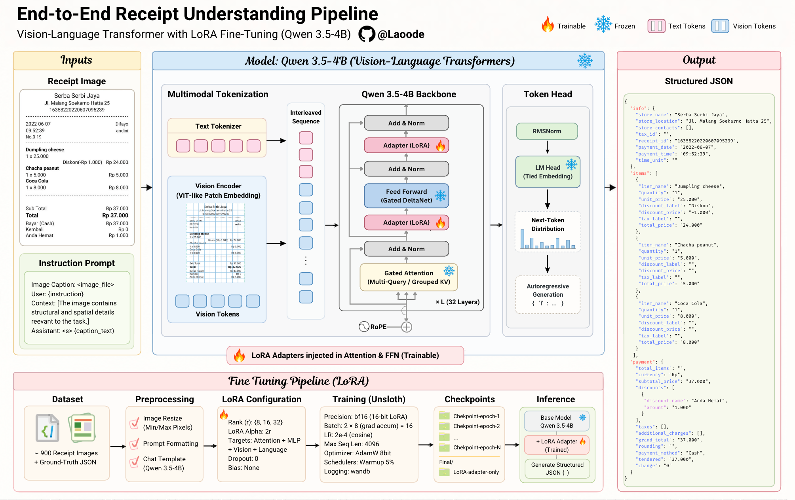

Klaudia's Qwen 3.5-4B fine-tune reads receipt images and returns structured JSON.
The output includes store details, line items, prices, and payment totals.
The model repository is
[Laoode/Qwen-3.5-4B-Klaudia on Oxen](https://www.oxen.ai/Laoode/Qwen-3.5-4B-Klaudia).[^research]

## Evaluation results

The fine-tuned model scored 87.02 on Entity F1 and 94.58 on digit accuracy in
the reported receipt experiment. The base Qwen 3.5-4B scored 69.93 and 77.87.
That is an increase of 17.09 and 16.71 points on the reported 0 to 100 scale.

| Model | Entity F1 | Group F1 | Aligned | ANLS* | Digit accuracy | JSON validity |
| --- | ---: | ---: | ---: | ---: | ---: | ---: |
| Gemma 4 E2B-it | 49.29 | 11.04 | 39.72 | 36.22 | 50.83 | 99 |
| Gemma 4 E4B-it | 58.61 | 18.46 | 51.17 | 73.49 | 60.38 | 100 |
| Qwen 3.5 2B | 58.88 | 18.40 | 50.36 | 68.96 | 71.15 | 98 |
| Qwen 3.5 4B | 69.93 | 28.17 | 63.05 | 77.22 | 77.87 | 100 |
| **Klaudia Qwen 3.5-4B fine-tune** | **87.02** | **71.88** | **84.90** | **93.99** | **94.58** | **100** |

The first three columns use KIEVal metrics. Entity F1 measures individual
extracted fields. Group F1 measures groups of related fields, such as line items.
The Aligned score reflects a correction-cost view of extraction quality.

ANLS* measures text similarity. Digit accuracy measures exact matches for numeric
price fields in this report. JSON validity measures whether an output parses
as JSON. A valid JSON output can still contain incorrect values.

These are the project's previously reported results, not a new run of the
current application. The public report does not include the evaluation split,
sample count, or evaluator configuration. The scores describe this experiment;
they do not establish accuracy on other receipt collections.

## Fine-tuning approach

The experiment uses LoRA adapters to adapt Qwen 3.5-4B to receipt images paired
with structured JSON (900-training/100-test). The diagram shows the receipt input, training process, and output format.

## Use in Klaudia

Document extraction has separate settings from the main agent. The backend
supports a self-hosted Qwen extraction endpoint through `KIE_MODEL`,
`VLLM_KIE_ENDPOINT`, and `VLLM_KIE_API_KEY`. The fine-tuned model is an option.

See the [environment template](https://github.com/Yudhyy/Klaudia/blob/development/.env.template) for provider settings.

[^research]: The dataset and the modeling and training code are private to the maintainer. For more information, contact [yudhymccodey@gmail.com](mailto:yudhymccodey@gmail.com).